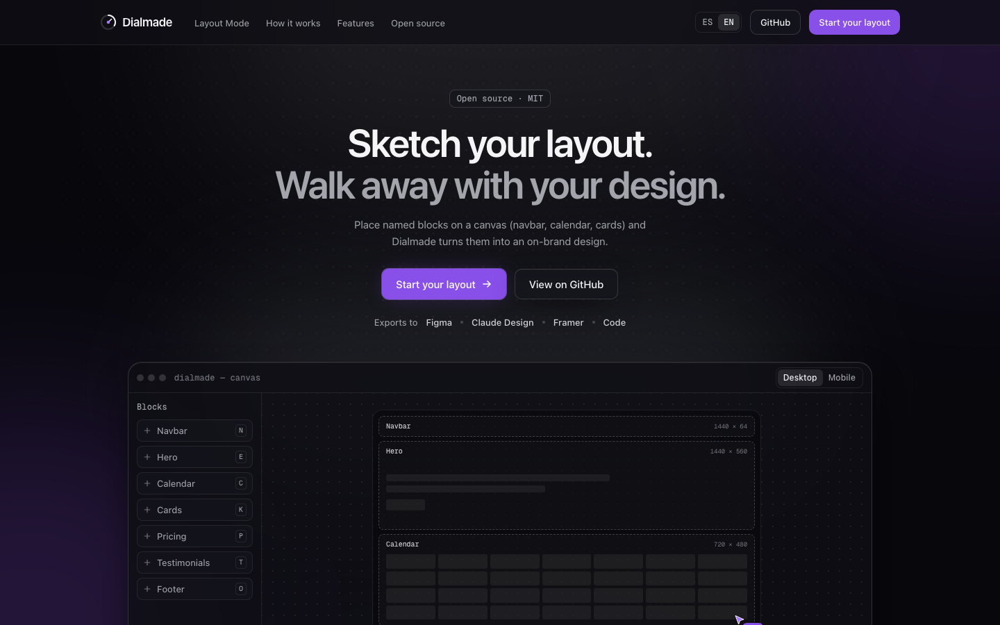

# Dialmade

**Sketch your layout. Walk away with your design.**

I'm a developer, not a designer, and every side project hit the same wall: the code was fine, the UI looked like a default template. Dialmade is the tool I wanted. You drop in your logo (or place a few named blocks on a canvas) and it builds a full design direction around it: palette, style, typography and real pages you can take to Figma or straight into code.

**Live:** [dialmade.com](https://dialmade.com) · Open source under MIT



## What it does

- **Palette from your logo.** It extracts the colors from your logo and builds light and dark themes that pass WCAG AA contrast, mapped to shadcn/ui roles.
- **Layout mode.** Place blocks like a navbar, hero, calendar or pricing on a canvas, and Dialmade infers the structure and makes it responsive.
- **Bring your brand.** Paste colors, CSS, design tokens or screenshots, and it merges them into the design instead of starting from zero.
- **Design with AI (optional).** Generates landing pages and dashboards with the Claude API. The output goes through a sanitizer and only uses your theme tokens, so it can't drift off-brand.
- **Export anywhere.** CSS variables, design tokens (DTCG), a Figma plugin that builds variables and pages with auto layout, or React + Tailwind code.

Everything except the AI part runs in the browser, and the app works fully without AI.

## How it's built

A TypeScript monorepo (pnpm workspaces) where each piece of the design engine is its own package, written as pure TS with no DOM so it can run in a web worker, on the server or in the Figma plugin.

| Package | What it does |
|---|---|
| `packages/palette` | Deterministic color engine in OKLCH: logo to seeds, scales and theme roles |
| `packages/layout` | Layout mode engine: block library, structure inference (XY-cut), responsive rules |
| `packages/doc` | The design document (Zod schema), JSON Patch edits and exporters |
| `packages/import` | Reads and merges the user's own brand assets |
| `packages/ai-render` | Output contract, sanitizer and quality gates for AI-generated pages |
| `packages/handoff` | Turns a design into a Figma plan or React + Tailwind code |
| `packages/figma-plugin` | Figma plugin that creates variables, text styles and pages |
| `packages/ui`, `packages/sections` | Themeable UI kit and page sections used in previews |
| `apps/web` | The app: Next.js (App Router), Tailwind v4, motion |
| `apps/preview` | Sandboxed origin that renders AI blocks in isolated iframes under a strict CSP |

A few decisions I'm happy with:

- **Color math lives in OKLCH**, so lightness steps look even to the eye and contrast checks are predictable.
- **AI output is never trusted.** Generated markup is sanitized, limited to theme tokens and rendered on a separate origin.
- **A hard monthly budget** caps AI spend. After the free tier you can bring your own Anthropic key.
- **Tests run with Vitest** across the engine packages and the app.

## Run it locally

You need Node 24+ and pnpm 10 (`corepack enable pnpm`).

```bash
pnpm install
pnpm dev          # http://localhost:3000
```

```bash
pnpm test         # Vitest
pnpm lint         # ESLint
pnpm typecheck    # strict TypeScript
pnpm build
```

The AI features are optional. To try them, copy `apps/web/.env.example` to `apps/web/.env.local` and add your `ANTHROPIC_API_KEY`.

## Credits

Uses material from [ui-ux-pro-max-skill](https://github.com/nextlevelbuilder/ui-ux-pro-max-skill) and [i-have-adhd](https://github.com/ayghri/i-have-adhd), both MIT. Details in [NOTICE](./NOTICE).

Built by [Diego González](https://www.linkedin.com/in/diegoogg).
