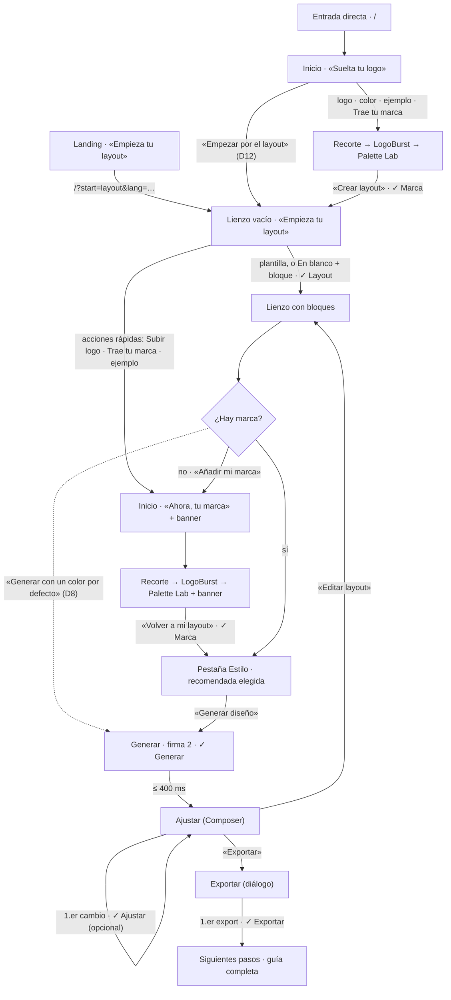

# Onboarding: tu primer diseño con el Modo Layout

**Estado:** borrador de diseño del 2026-10-10, **pendiente de que lo valides**. **No está implementado.** Lo integra después en `apps/web` el chat que conecte el Modo Layout al flujo (ver §10). Este documento no toca `apps/web`, `packages/` ni `docs/design/`.

**Depende de:**
- la Fase B del Modo Layout (`LayoutStep` conectado al flujo y DesignDoc v2), descrita en `handoff-modo-layout.md`;
- **un borrador del layout que sobreviva al desmontaje de `LayoutStep`** (`hooks/useLayoutDraft.ts`, §10.2). Hoy el chat del Modo Layout usa un store propio por montaje (`modo-layout-decisiones.md` #27): es un requisito para ese chat, porque si no, el layout se pierde al ir a la marca;
- **supuesto:** en el primer Generar, `productType` es el que tenga el doc (por defecto `generic`), con su receta y su copy por defecto. Se cambia en Ajustar (`BriefPanel` → `ProductChips`). Si `LayoutStep` lo pregunta antes, lo decide el chat del Modo Layout.

**Enfoque: plantilla de arranque y guía ligera.** No hay tour ni modal de bienvenida. El usuario elige una plantilla de layout (o empieza en blanco), la hace suya en el lienzo y la guía solo añade cinco piezas finas:
- la checklist **«Tu primer diseño»**, montada sobre la `ui/StatusBar` que ya existe;
- **2 coachmarks** como máximo;
- pistas en línea y estados vacíos que enseñan;
- un banner que recuerda que el layout espera mientras pones la marca;
- unas tarjetas de **«Siguientes pasos»**.

Todo se puede saltar y todo funciona sin IA ni cuenta.

**Fuentes:**
- `CLAUDE.md`, `docs/design/DESIGN-BRIEF.md` y `docs/design/que-quieres-crear.md` (esta copia).
- De la copia vigente en `/Users/diegoguerrero/Desktop/designApp/docs/`:
  - `research/INFORME.md` §2, §3, §9 y §16;
  - `design/modo-layout.md`, `modo-layout-spec.md`, `modo-layout-critique.md` (si chocan, manda la crítica) y `handoff-modo-layout.md`;
  - `design/referencias-mobbin.md` (vista 11 = **11B Replit + 11F Klaviyo**).
- El código de `apps/web` en `main` (commit 1cffe18), leído en esta copia.

---

## 0. Respuesta en 3 líneas

1. **La guía no es un tour.** Es una capa fina sobre el producto: una checklist en la `StatusBar`, 2 coachmarks, pistas en línea, estados vacíos que dicen qué hacer y tarjetas de «Siguientes pasos». Todo se salta.
2. **Ruta:** plantilla en el lienzo (≤ 10 s) → marca → estilo y **Generar** (momento firma) → Ajustar (opcional) → Exportar. Objetivo: **primer diseño con tu marca en ≤ 2 min**, sin IA ni cuenta.
3. **El orden está abierto (D1).** Tu pedido dice layout → marca; INFORME §16.1 dice marca → layout. Propongo **seguir la entrada**: la landing empieza por el layout y la entrada directa por la marca. Las piezas son las mismas. **Con D1 = (b), el CTA de la landing no puede decir «Empieza tu layout»**: habría que cambiarlo en `apps/site`.

---

## 1. Objetivo y métrica de éxito

**Objetivo:** que un dev que llega por primera vez salga de una sola sesión con un diseño que cumpla tres cosas:
- está generado desde **su** layout;
- está pintado con **su** marca;
- está **exportado** a su herramienta.

Con 3 a 5 participantes, cada uno vale un 20 %: por eso los objetivos del spike se cuentan en **personas**, no en porcentajes. Los porcentajes por sesión **requieren D18-b**.

| Métrica | Definición | Objetivo del spike (propio, sin validar) |
|---|---|---|
| **TTFD** (principal) | Desde que se ve la primera pantalla (Inicio o lienzo) hasta que termina el primer Generar con **marca real**: logo, color confirmado en «No tengo logo» (aunque sea el mismo hex que `DEFAULT_PRIMARY`) o guía importada. El logo de ejemplo y «Generar con un color por defecto» (D8) **no cuentan** | Mediana **≤ 2 min**; el más lento ≤ 4 min |
| Primer layout | Desde la entrada hasta que hay ≥ 1 bloque en el lienzo | ≤ 10 s desde la landing |
| Llegan a Generar | Participantes que generan al menos una vez | **≥ 4 de 5** |
| Primer export | Participantes que exportan algo en la primera sesión | **≥ 3 de 5** |
| «Se parece a lo que dibujé» | Pregunta del 1 al 5 justo después de generar (criterio del spike) | ≥ 4 de media |
| Sin ayuda | Participantes que llegan a Generar sin preguntar al moderador | **≥ 4 de 5** |
| Saltan la guía | Participantes que la ocultan antes de Generar | Solo se observa. **Si son ≥ 2 de 5, la guía estorba** |
| Paridad de acceso | Recorrido completo solo con teclado y con lector de pantalla (VoiceOver y NVDA) | 0 bloqueos |

**Cómo se mide, sin telemetría ni servicios de pago:**
- En las pruebas moderadas del spike del Modo Layout, con 3 a 5 devs (spec §8).
- En desarrollo, `?debug=onboarding` (solo con `NODE_ENV=development`) pone `performance.mark` en la entrada, el primer bloque, la marca, el primer Generar y el primer export, y los imprime con `console.table`. **Viven en memoria: no se guardan ni se envían.**

**Camino feliz de referencia (E1, desde la landing, con su logo):**

| t | Qué pasa | Checklist |
|---|---|---|
| 0 s | Clic en «Empieza tu layout» en la landing | — |
| 1 s | Lienzo vacío con plantillas. Es la carga de la página: el foco queda al principio del documento y «Saltar al contenido» lleva a `#main` | Tu primer diseño · 0 de 5 · Siguiente: elige una plantilla |
| 5 s | Clic en «Landing». La plantilla aterriza (≤ 400 ms) y sale C1 en el Hero | 1 de 5 · Layout ✓ · Siguiente: añade tu marca |
| 10–25 s | Mueve el Hero, añade «Calendario» desde la librería y le pone la nota «semanal» | (C1 se cierra) |
| 30 s | «Añadir mi marca» → Inicio en modo «Ahora, tu marca», con el banner «Tu layout te espera · 10 bloques» | (sin checklist; banner visible) |
| 35–60 s | Suelta su logo → recorte → LogoBurst (≤ 900 ms) → Palette Lab | LabBar: Layout ✓ · Marca ✓ · Paleta ✓ · AA ✓ · Siguiente: genera tu diseño |
| 65 s | «Volver a mi layout» → lienzo con la pestaña Estilo abierta y la recomendada ya elegida | 2 de 5 · Siguiente: genera tu diseño |
| 70 s | «Generar diseño» → momento firma (≤ 900 ms) → Ajustar. **Aquí termina el TTFD** | 3 de 5 · Generar ✓ · Siguiente: exporta tu diseño |
| 75–100 s | Selecciona el Hero y cambia su título en los ajustes de la sección (C2) | 4 de 5 · Ajustar ✓ |
| 110 s | «Exportar» → «Copiar prompt» de Claude Design | 5 de 5 → un solo toast: «Prompt para Claude Design copiado · Tu primer diseño está listo.» |

**En E2 (entrada directa):** Inicio → logo, recorte y paleta (~40 s) → «Crear layout» → plantilla con su marca → Generar. TTFD de ~60 s.

---

## 2. Principios

1. **Hacer antes que leer.** No hay pantalla de bienvenida, tour por pasos, vídeo ni overlay que oscurezca la pantalla. Cada pantalla enseña con su estado vacío.
2. **Una decisión y un CTA principal por pantalla** (regla de i-have-adhd). `glow-purple` solo va en el CTA principal, el elemento seleccionado y el destino válido.
3. **Primero estados vacíos, después coachmarks.** Un coachmark solo existe donde ningún estado vacío lo puede explicar. **Máximo 2** en todo el onboarding, de uno en uno y una sola vez cada uno.
4. **Ayuda por evento, nunca por tiempo.** Ninguna pista aparece por un temporizador ni se cierra sola (WCAG 2.2.1). Se van con la acción, con «Entendido» o con Esc. Los toasts de sonner sí se cierran solos (4 s), así que **cada acción de un toast tiene un equivalente persistente** (§5.0).
5. **Solo bloquea lo imprescindible.** Generar pide ≥ 1 bloque. Si falta la marca, el CTA pide la marca, pero hay una salida secundaria (D8).
6. **Completa sin IA y sin cuenta.** El primer Generar **nunca** llama a la IA. Si `useAiCopy().available` es `false`, la IA no se menciona.
7. **Todo arrastre tiene alternativa** con un solo puntero sin arrastrar y con teclado (WCAG 2.5.7). Space y Enter solo cogen y sueltan. `aria-live` anuncia qué se movió y adónde.
8. **Motion con presupuesto.** Como mucho **2 momentos firma por sesión** (LogoBurst y el primer Generar), los dos saltables. Nada se anima en bucle.
9. **Honestidad.** «Pronto» donde algo no existe. Nada se corrige en silencio. Si el diseño no se guarda al recargar, se dice. El logo nunca sale del navegador.
10. **La estética no se inventa.** Se reutiliza lo elegido (11B Replit, 11F Klaviyo, 1B Higgsfield, 3A Buffer + 3C Replit, 4B Mistral) y las primitivas de la app (`StatusBar`, `Tooltip`, `DropSlot`, toasts, tokens `--app-*`). **Cada patrón visual nuevo queda pendiente de que elijas referencia (§11).**

**Qué es de la guía y qué es del producto:**

| Pieza | Dueño | ¿Solo la primera vez? |
|---|---|---|
| `TemplatePicker`, hueco «Añade lo que falta», estados vacíos del lienzo, CTA «Añadir mi marca», ayuda del campo «Nota» | `LayoutStep` (chat del Modo Layout) | **No**: se ven siempre |
| Banner «Tu layout te espera», `HomeHero` en modo «Ahora, tu marca», CTA de `LabBar` según de dónde vienes, soltar el logo sobre el lienzo | Flujo (`PaletteFlow`, `HomeHero`, `LabBar`) | **No**: siempre que vengas del layout |
| Aviso «Tu diseño anterior no se guardó», aviso en el pie de Exportar | Guía (store) y `ExportDialog` | **No**: siempre que aplique |
| Checklist «Tu primer diseño», C1, C2, pista de la librería, pestaña Estilo automática, «Siguientes pasos» | Guía (`OnboardingProvider`) | **Sí**: mientras `status` sea `active` |
| Menú «Ayuda» | `AppHeader` | Siempre |

---

## 3. Entradas al onboarding

| # | Entrada | Cómo llega | Primera pantalla | Orden de la sesión |
|---|---|---|---|---|
| **E1** | Landing → «Empieza tu layout» | `{NEXT_PUBLIC_APP_URL}/?start=layout&lang=es`, con `&template=` opcional (un `SetTemplateId` de `@dialmade/layout`, hoy `landing` o `saas-app`, o `blank`; D4) | Lienzo vacío con plantillas (`TemplatePicker`) | `layout-first`: Layout · Marca · Generar · Ajustar · Exportar |
| **E2** | Directo a la app | `/` | Inicio, «Suelta tu logo» (como hoy) | `brand-first`: Marca · Layout · Generar · Ajustar · Exportar |
| **E2b** | Directo, pero prefiere empezar por el layout | Enlace «Empezar por el layout» en Inicio (D12) | Igual que E1 | `layout-first` |
| **E3** | «Ya tengo marca o app» (cuando se fusione «Trae tu marca») | Desde Inicio | «Trae tu marca» → Palette Lab o «Usar mi guía → Layout» | `brand-first`. En Estilo, «Tu guía de estilo» va primera y ya elegida |
| **E4** | Vuelve con la guía terminada | `status: "done"` | La de su entrada | Sin checklist ni coachmarks |
| **E5** | Vuelve con la guía a medias | `status: "active"` | La de su entrada | El orden **sale de la entrada de esta sesión**, no de la anterior. Las pistas ya vistas no se repiten. Si perdió un diseño al recargar, lo avisa una vez (V18) |
| **E6** | La ocultó | `status: "hidden"` | La de su entrada | Sin checklist, coachmarks ni «Siguientes pasos». Se recupera en el menú «Ayuda» |
| **E7** | Pantalla de menos de 640 px | Cualquiera | La lista de capas sustituye al lienzo (spec §3.3) | Igual. Checklist compacta y coachmarks como filas en línea |
| **E8** | Almacenamiento bloqueado (ventana privada) | Cualquiera | La de su entrada | Igual. La guía vive en memoria y se olvida al recargar. **No se avisa** |

**Reglas de entrada**
- **Se resuelve en el servidor, sin parpadeo.** `app/page.tsx` lee `searchParams`, los valida contra una lista cerrada (`lib/onboarding/entry.ts`) y pasa `initialEntry` a `<PaletteFlow>`. Así el estado inicial (`layout` o `drop`) es el mismo en servidor y cliente, y E1 nunca enseña el Inicio un instante.
- **Idioma.** `lang` viaja en la URL porque la landing y la app tienen orígenes distintos y no comparten localStorage. El `bootScript` de `app/layout.tsx` lo lee de `location.search` y fija `<html lang>` y `dialmade.locale` antes de hidratar. **El texto no sale en ese idioma antes del primer paint:** `I18nProvider` usa `getServerSnapshot = defaultLocale`, así que el HTML del servidor sale en `es` y pasa a `en` al hidratar, como hoy con `dialmade.locale`. En E1 casi no se nota, porque la primera vista es el esqueleto del lienzo. Evitarlo del todo es la decisión D21 (cookie de idioma).
- **`template` solo preselecciona** la carta. Nunca la aplica: el usuario confirma con un clic.
- **Limpieza:** tras montar, `history.replaceState` deja la URL en `/`. Recargar ya no fuerza la entrada.
- **Valores desconocidos** se ignoran sin error. Un `start` inválido entra por E2.
- **Nada personal en la URL:** solo `start`, `lang` y `template`.
- **Guía terminada (E4):** con `?start=layout` aterriza igual en el lienzo, sin guía.

---

## 4. Mapa del flujo



| Paso de la guía | `FlowStep` | Vista o componente | Ítem de la checklist |
|---|---|---|---|
| Primer layout | `layout` (sustituye a `create`) | `LayoutStep` + `TemplatePicker` | Layout |
| Marca | `drop` → `crop` → `extracting` → `palette` | `HomeHero`, `LogoCropper`, `LogoBurst`, `PaletteLab` | Marca |
| Estilo y Generar | `layout` | `LayoutStep/StylePicker` + `GenerateBar` | Generar |
| Ajustar | `compose` | `Composer` | Ajustar (opcional) |
| Exportar | No es un `FlowStep`: lo abre el estado `exportFor` | `ExportDialog` | Exportar |

**Cómo se juntan las dos rutas**
- **E1:** la marca se pide **justo a tiempo**: con el CTA de la barra inferior, el ítem «Marca» de la checklist, las acciones rápidas del `TemplatePicker` o soltando una imagen sobre el lienzo. El flujo de marca es el de hoy, con el banner «Tu layout te espera».
- **Volver:** siempre que el usuario sale del lienzo o de Ajustar hacia la marca, el flujo guarda de dónde viene: `returnTo: "layout" | "compose"`. Lo fijan `addBrandForLayout()` y también `showPalette()` (el ítem «Marca» del stepper y «Editar marca» en Ajustar) cuando se sale de `layout` o de `compose`. No depende del orden de la sesión.
- **El CTA de `LabBar` sale del estado:** `returnTo === "compose"` → «Volver a Ajustar»; `returnTo === "layout"` o hay bloques en el borrador → «Volver a mi layout»; 0 bloques → «Crear layout». El banner «Tu layout te espera» solo sale con `returnTo === "layout"`.
- **E2:** igual que hoy hasta el Palette Lab, cuyo CTA pasa a «Crear layout» (sin bloques todavía).
- **Desde Generar** no hay diferencias entre las dos rutas.

---

## 5. Pasos

Los IDs `M#` remiten a la tabla de motion (§7) y los `V#` al catálogo de estados vacíos (§6). Las claves `onboarding.*` van en el namespace nuevo (§9). Las demás son **propuestas** para el namespace de su dueño.

### 5.0 Piezas comunes de la guía

#### Checklist «Tu primer diseño» (`OnboardingChecklist`)

**Qué es:** la `ui/StatusBar` que ya usa `LabBar` («Marca ✓ · Paleta ✓ · AA ✓ · Siguiente: …»), con una ampliación de API (§10.3) y 5 ítems. **No sustituye al stepper**: es el mismo patrón que ya conviven en el Palette Lab.

**Dónde vive** (posición pendiente de P1, §11):
- **en el lienzo:** una barra flotante arriba, que es la `StatusBar` tal cual (`glass`, `rounded-panel` de 20 px; no una pastilla `rounded-full`, que el brief reserva a los avatares). El `FlowStepper` ya ocupa arriba al centro (`mx-auto w-fit`): la posición respecto a él (por ejemplo, justo debajo y alineada con el marco del lienzo) es parte de P1;
- **en Ajustar:** en la `ComposerTopBar`, o justo debajo;
- **en el Palette Lab:** no se monta. `LabBar` ya tiene su `StatusBar`; con `returnTo === "layout"` o con bloques en el borrador, añade delante el ítem «Layout» (con ✓ si hay bloques);
- **no aparece** en Inicio, en el recorte ni en LogoBurst: Inicio es su propio estado vacío.

**Cómo se ve**
- **Escritorio:** «Tu primer diseño · 2 de 5 · Layout ✓ · Marca ✓ · Generar · Ajustar (opcional) · Exportar · Siguiente: genera tu diseño».
- **Menos de 640 px:** una línea, «Tu primer diseño · 2 de 5 · Siguiente: genera tu diseño», con el botón «Ver los pasos» para desplegar la lista (M21).
- **Menú «⋯»:** «Ocultar la guía». Lanza el toast «Guía oculta. La recuperas en «Ayuda», arriba a la derecha.».

**Cómo funciona**
- **Estados de un ítem:** pendiente · paso actual · hecho · saltado (solo Ajustar) · no disponible. Un ítem no disponible lleva `aria-disabled` y su motivo en el `Tooltip`; el motivo reutiliza `layout.generate.needBlock` o `flow.stepper.lockedGenerate`, sin claves propias. El nombre accesible es «Layout, hecho».
- **El `Tooltip` no se ve en táctil** (solo se abre con ratón o `:focus-visible`): en la lista desplegada de móvil, el motivo va como texto visible bajo el ítem.
- **Cada ítem disponible es un botón** que lleva a su paso.
- **Se deriva, no se guarda** (§8.1). Así no miente después de un deshacer ni tras recargar.
- **«Siguiente»** es siempre el primer ítem sin hacer, salvo Ajustar, que es opcional: tras Generar, «Siguiente» es «exporta tu diseño». Con Layout sin hacer dice «elige una plantilla»; tras «En blanco», «añade tu primer bloque».

| Ítem | Hecho cuando | Bloqueado cuando | Al hacer clic |
|---|---|---|---|
| Layout | Hay ≥ 1 bloque en alguna pantalla. Una plantilla ya cuenta | Nunca | Lleva al lienzo |
| Marca | Existe `primary` con `brandSource` `logo`, `color`, `import` o `sample` (este último con la etiqueta «Marca (ejemplo)»). Con `default` dice «Marca provisional» y **sin ✓** | Nunca | Sin marca: Inicio en modo «Ahora, tu marca». Con marca: Palette Lab |
| Generar | Alguna pantalla tiene ≥ 1 bloque con la huella `generated` | No hay bloques | Lienzo, con el foco en «Generar diseño» |
| Ajustar (opcional) | El doc es distinto del que dejó el último Generar (§8.1) | Ninguna pantalla tiene diseño generado | Ajustar |
| Exportar | Llegó la señal `exported` en esta sesión | Ninguna pantalla tiene diseño generado | Abre el diálogo Exportar |

**Cierre**
- Ajustar queda «saltado» cuando un export sale bien sin cambios desde `docAfterGenerate`. Abrir el diálogo Exportar y cerrarlo sin exportar no cambia nada.
- `exported` **no cambia `status`**: marca el ítem Exportar. La checklist se queda en «5 de 5» hasta que se cierran los «Siguientes pasos» de cierre (§5.6). `status` pasa a `"done"` al pulsar «Cerrar» en ellos, o en la siguiente carga si ya hubo un primer export con marca real (`firstExportDone: true` en `dialmade.onboarding`, §8.2). Después, la checklist desaparece (M21).
- Con marca provisional (`brandSource === "default"`), el primer export no cierra la guía (§5.5): «Cerrar» en los «Siguientes pasos» solo oculta el grupo, y `status` pasa a `"done"` en cuanto Marca tiene ✓ (Exportar ya está hecho en la sesión).

**Anuncios:** con la guía activa, la `StatusBar` va con `announce="off"` y el progreso lo anuncia el `PoliteAnnouncer` de la guía, en un solo mensaje junto al del evento: «Plantilla Landing en el lienzo: 9 bloques en 2 pantallas. Hecho: Layout. Siguiente: añade tu marca.».

#### Coachmarks (máximo 2)

| Id | Ancla | Aparece cuando | Se cierra cuando |
|---|---|---|---|
| **C1** `blocks` | El primer bloque de contenido (Hero o KPIs) tras aterrizar la plantilla, o el primer bloque insertado (lo que pase antes) | Una sola vez | Señal `block-touched` (seleccionar con el puntero, coger con Space/Enter o con pointerdown + movimiento, mover o redimensionar; **nunca por un `focus`**, ni por Tab ni por el foco programático de §5.1), «Entendido» o Esc |
| **C2** `adjust` | La primera sección de la página en Ajustar (el `[data-dl-id]` del primer `SectionFrame` visible, normalmente el Hero). Es enfocable: `role="group"`, `tabindex=0` | Primera entrada en Ajustar tras el primer Generar, al terminar M17 | Primera selección de sección (señal `section-selected`), primer cambio en el doc, «Entendido» o Esc |

**Hoy no hay edición de texto en línea en Ajustar:** los textos se cambian en `SelectionToolbar` → `KnobsPanel` → `KnobField`. Por eso C2 se ancla a la sección y no a un texto. Cuando llegue el `contenteditable` (INFORME), el ancla pasa a ser ese texto (dependencia en §10.1).

**Reglas**
- **Uno a la vez**, con una cola en `OnboardingProvider`.
- **Describir no es mostrar.** El cuerpo del coachmark se monta (sin mostrarse) en el mismo frame en que aparece su ancla, y el ancla ya lo referencia con `aria-describedby`, que puede apuntar a contenido oculto. `showPopover()` se llama después, cuando se cumple «Esperan».
- **Esperan para mostrarse:** nunca salen durante un drag, con un bloque cogido por teclado, durante un momento firma ni con un diálogo abierto. Esperan a que termine y a 400 ms de calma.
- **Se ocultan si se abre algo encima.** Mientras haya abierto un `Popover`, un menú contextual, la `SelectionToolbar` o un diálogo, el coachmark se oculta con `hidePopover()` **sin marcarse como `seen`**, y vuelve cuando se cierra. `OnboardingProvider` expone un contador `overlayOpen` que `Popover` y los menús registran en su `onOpenChange`.
- **No se cierran solos** por tiempo (WCAG 2.2.1).
- **No tapan su ancla ni el control con foco** (WCAG 2.4.11). Se colocan arriba o abajo y se giran si no caben. Ancho máximo de 320 px.
- **Sin hotspots que laten:** un punto que pulsa en bucle incumple WCAG 2.2.2.
- **Dos controles:** «Entendido» y «Ocultar la guía». Zonas de toque ≥ 24×24 px (2.5.8).
- **C2 lleva siempre fondo opaco** (`bg-app-elevated`): vive sobre la preview del usuario, que puede ser clara, y un fondo `glass` deja el texto `--app-text-muted` en ≈ 3:1.

**Cuando el foco no está en el ancla.** El lector solo lee el coachmark por el `aria-describedby` del ancla. Hay tres casos en que el foco está en otro sitio:
- **C1 tras una inserción** (por ejemplo, con «En blanco»): el foco sigue en la librería. Se añade una sola vez el título y el cuerpo de C1, más `onboarding.coach.blocks.keys`, al final del anuncio de esa inserción (`layout.announce.inserted`). El foco no se mueve.
- **C2:** al entrar en Ajustar, el `Stage` enfoca su h1 (hoy el Composer no tiene h1 y enfoca la región). Mientras C2 esté en cola, ese elemento lleva `aria-describedby` al cuerpo de C2.
- **V18:** el h1 de la primera pantalla lleva `aria-describedby` a la línea de V18 mientras se muestre.

**Foco al cerrar** (WCAG 2.4.3; nada deja el foco en el `body`)
- C1 o C2 cerrado con el foco dentro → al ancla.
- «Ocultar la guía», en un coachmark o en el menú de la checklist → al botón «Ayuda» del `AppHeader`, que es donde el toast dice que se recupera.
- Tarjeta de «Siguientes pasos» hecha → la siguiente tarjeta; si no queda ninguna, el h1 del `Stage`.
- «Ocultar» o «Cerrar» del grupo de «Siguientes pasos», o checklist que desaparece con el foco dentro → el h1 del `Stage`.

**Accesibilidad (`ui/Coachmark`)**
- Es un elemento `popover="manual"`, no un portal. C1 se coloca **justo después de su ancla en el DOM**, como **hermano** del elemento arrastrable y nunca como hijo (los hijos de un `role="button"` son presentacionales y el lector dejaría de ver el diálogo). Así va en el top layer sin romper el orden de Tab: sus botones son la siguiente parada tras el ancla.
- C2 se pinta desde `Composer/Canvas`, junto a la `SelectionToolbar`, **fuera del marco escalado y fuera de `PageRenderer`** (no se toca `packages/sections`, que también se exporta como HTML estático). Se coloca con `useToolbarPosition`.
- Lleva `role="dialog"`, `aria-modal="false"` y `aria-labelledby` apuntando a su título.
- **El ancla concatena el id del cuerpo con su propio `aria-describedby`, nunca lo sobrescribe.** En C1 se pasa por la prop `aria-describedby` de `DraggableItem` (o del componente del bloque con el mismo patrón), que ya hace `cn(DND_INSTRUCTIONS_ID, …)`: así no se pierden las instrucciones del arrastre. En C2, `Coachmark` añade el id al atributo del `[data-dl-id]` por `anchorRef` y lo quita al cerrarse.
- **No se anuncia por ninguna región live**, salvo el caso de C1 tras una inserción (arriba).
- **No roba el foco.**
- **Dentro de `ThemeScope`** lleva la clase `.app-chrome`.
- **Por debajo de 640 px** no flota: es una fila de pista en línea dentro del panel o de la lista, con el mismo texto.

#### Toasts: cada acción tiene un equivalente persistente

Sonner cierra los toasts a los 4 s (`Providers` no fija `duration`). Así que ninguna acción vive solo en un toast:

| Toast | Acción del toast | Equivalente persistente |
|---|---|---|
| «Generado con 2 avisos» | «Ver avisos» | Botón «2 avisos» en la `GenerateBar` hasta el siguiente Generar (`layout.generate.warningsButton(n)`) |
| Generado con un color por defecto | «Añadir mi marca» | El ítem Marca de la checklist y «Editar marca» en la `ComposerTopBar` |
| «Guía oculta» | «Deshacer» | «Mostrar la guía» en el menú «Ayuda» |
| «Cards quedó dentro de Sección» | «Deshacer» | ⌘Z / Ctrl+Z |
| Borraste todos los bloques | «Deshacer» · «Ver plantillas» | ⌘Z / Ctrl+Z · «Ver plantillas» en V2 |

Si una acción nueva no tiene equivalente, su toast lleva `duration: Infinity` y botón de cerrar.

#### Pista en línea de la librería

- **Texto:** «Haz clic en un bloque para añadirlo, o arrástralo al lienzo.».
- **Dónde:** en la cabecera de la librería, como texto `--app-text-muted`. No es un coachmark.
- **Se va** con el primer bloque insertado desde la librería (señal `block-inserted`).

#### Banner «Tu layout te espera» (`LayoutReturnBanner`)

- **Qué es:** una franja sobre el `Stage` con «Tu layout te espera · 10 bloques» y el enlace «Volver a mi layout» (el mismo nombre que el CTA de `LabBar`, WCAG 3.2.4). Patrón pendiente (P5, §11).
- **Cuándo:** mientras `returnTo === "layout"`, en Inicio, Recorte y Palette Lab. Es producto: sale con y sin guía.
- **Accesibilidad:** es una región con nombre «Tu layout». Es contenido estático y no se anuncia.
- **Motion:** M9.

#### Anunciador de la guía (`PoliteAnnouncer`)

- **La guía tiene una región `aria-live="polite"` propia**, montada en `PaletteFlow` junto a `DndAnnouncer`, que sigue siendo la única región assertive (drag). No es la única polite: el `<Toaster>` de sonner tiene la suya y la `StatusBar` de `LabBar` conserva su `role="status"`.
- **Si el evento muestra un toast, el toast es el anuncio** y `PoliteAnnouncer` no lo repite. Ningún evento lleva toast y anuncio con el mismo texto.
- **Un mensaje a la vez.** Los mensajes de un mismo evento se combinan en uno.
- **Nunca pisa al drag:** si `DndAnnouncer` habló hace menos de 1 s (`lastAnnouncedAt`, §10.3), el mensaje espera.
- **Se expone con `usePoliteAnnounce()`** en `src/hooks/`, porque lo usan la guía y el `LayoutStep` (Generar listo, estilo elegido).

#### Prioridad de Esc

1. Cancelar el drag o el gesto de teclado (`DndProvider` y lienzo).
2. Saltar el momento firma.
3. Cerrar el `Popover`, el menú contextual o el diálogo abierto. Ya consumen Esc en captura con `stopPropagation` (como `Composer/Popover`).
4. Cerrar el coachmark. `Coachmark` gestiona Esc con `preventDefault()` y `stopPropagation()`.
5. Deseleccionar (`useComposerShortcuts` y lienzo). La deselección comprueba `event.defaultPrevented`, como ya hace `useComposerShortcuts`, así que con C2 abierto Esc solo cierra C2.

#### Microcopy común (`onboarding.ts`)

| Clave | es | en |
|---|---|---|
| `onboarding.progress.title` | Tu primer diseño | Your first design |
| `onboarding.progress.label` | Pasos de tu primer diseño | Steps of your first design |
| `onboarding.progress.count(done, total)` | 2 de 5 | 2 of 5 |
| `onboarding.progress.items.layout` | Layout | Layout |
| `onboarding.progress.items.brand` | Marca | Brand |
| `onboarding.progress.items.brandSample` | Marca (ejemplo) | Brand (sample) |
| `onboarding.progress.items.brandProvisional` | Marca provisional | Placeholder brand |
| `onboarding.progress.items.generate` | Generar | Generate |
| `onboarding.progress.items.adjust` | Ajustar | Adjust |
| `onboarding.progress.items.export` | Exportar | Export |
| `onboarding.progress.optional` | opcional | optional |
| `onboarding.progress.states.*` | pendiente · paso actual · hecho · saltado · no disponible | pending · current step · done · skipped · unavailable |
| `onboarding.progress.itemLabel(label, state)` | Layout, hecho | Layout, done |
| `onboarding.progress.next.pickTemplate` | elige una plantilla | pick a template |
| `onboarding.progress.next.firstBlock` | añade tu primer bloque | add your first block |
| `onboarding.progress.next.brand` | añade tu marca | add your brand |
| `onboarding.progress.next.generate` | genera tu diseño | generate your design |
| `onboarding.progress.next.export` | exporta tu diseño | export your design |
| `onboarding.progress.expand` | Ver los pasos | Show the steps |
| `onboarding.progress.collapse` | Ocultar los pasos | Hide the steps |
| `onboarding.progress.menu` | Opciones de la guía | Guide options |
| `onboarding.hideGuide` | Ocultar la guía | Hide the guide |
| `onboarding.coach.gotIt` | Entendido | Got it |
| `onboarding.toasts.hidden` | Guía oculta. La recuperas en «Ayuda», arriba a la derecha. | Guide hidden. Bring it back from “Help”, top right. |
| `onboarding.announce.progress(step, next)` | Hecho: Layout. Siguiente: añade tu marca. | Done: Layout. Next: add your brand. |

**Notas:** «Siguiente:» lo pinta la `StatusBar` con `common.status.next`; por eso los `next.*` van en minúscula. El «Deshacer» de los toasts usa una clave compartida nueva, `common.actions.undo`, porque hoy solo existe `composer.undoAction`. Los motivos de «no disponible» reutilizan `layout.generate.needBlock` y `flow.stepper.lockedGenerate`.

---

### 5.1 Paso Layout: primer layout

**Objetivo:** que el usuario tenga en ≤ 10 s un layout en el lienzo y sepa moverlo, redimensionarlo y anotarlo.

**Qué ve.** El lienzo es el de la spec (11B Replit + 11F Klaviyo). La guía solo se ancla a algunas zonas.
- **Centro:** rejilla de puntos con el marco Desktop, Tablet o Móvil y la barra flotante con deshacer, rehacer y dispositivo.
- **Derecha:** la librería en grilla con «Sugeridos». Al seleccionar un bloque, el panel pasa a ser su inspector, como en Klaviyo.
- **Izquierda:** el panel «Pantallas».
- **Abajo:** la barra Dibujar · Editar · Mano · **Generar**. «Chat» no se muestra en el MVP (D13).
- **Arriba:** la checklist.

**Estado vacío inicial (`TemplatePicker`, V1).** Sigue el estado vacío de 11B Replit: un bento de cartas y, debajo, una fila de acciones rápidas.
- **h1:** «Empieza tu layout». Es la misma frase del CTA de la landing, para dar continuidad. Si se llega con un cambio de paso, el `Stage` lleva ahí el foco. En la carga de la página (E1) no lo mueve: el foco queda al principio del documento, como hoy.
- **Subtítulo:** sin marca, «Elige un punto de partida y hazlo tuyo. Tu marca la añades antes de generar.»; con marca, «Elige un punto de partida y hazlo tuyo. Ya lleva tu marca.».
- **Cartas** (reutilizan `KindCard` y `MiniPreview`, movidos a `LayoutStep/TemplatePicker/`). Los ids y los bloques **son del chat del Modo Layout**: el tipo es `SetTemplateId | "blank"` de `@dialmade/layout`, y los bloques de cada pantalla están en `SCREEN_TEMPLATES` (`packages/layout/src/templates.ts`, rama `feat/layout-mode`). Este documento no los fija:

  | id | Nombre (es / en) | Tipo | Pantallas | Requiere |
  |---|---|---|---|---|
  | `landing` | Landing / Landing | Web pública | Inicio + Precios | Todo existe |
  | `saas-app` | «SaaS app» o «Dashboard» (pendiente, D4) | Pantalla de app, navegación lateral | Dashboard + Ajustes + Login | Login usa `ui.form` (nuevo del MVP) |
  | `blank` | En blanco / Blank | Pregunta «¿Web pública o pantalla de app?» | 1 | — |
  | `booking` *(propuesta, D4)* | App de reservas / Booking app | Pantalla de app, navegación superior | Reservas | `ui.calendar`, `ui.list` y `ui.form`. **Si falta alguno, la carta no se muestra** |

- **Minis:** sin marca se pintan con un tema neutro, con los grises de la app; **no con `DEFAULT_PRIMARY`**, para no sugerir una marca. Con marca, en sus colores.
- **Contenido de ejemplo:** el bloque Logos usa **solo logos ficticios o métricas**. Los precios van en **MXN o USD con formato es-MX**, no en «€» (`pendientes.md`).
- **Recomendada** (insignia `create.badges.recommended`):
  - E1: `landing`, o la carta de `?template=`;
  - E2: según `previewKind`: `landing` → `landing`, `app` → `saas-app`, `brand` → `landing`;
  - «¿No sabes cuál?» abre `RecommendQuestion` (`firstUseQuestion`): launch → `landing`, build → `saas-app`, handoff → `landing`, porque la guía de estilo se genera siempre (D15).
  - `recommendKind()` devuelve un `OutputKind` (handoff → `brand`, que no es una plantilla): la traducción a plantilla la hace `TemplatePicker` en la app, sin cambiar `@dialmade/catalog` (§10.3).
- **Acciones rápidas** (solo sin marca): «Subir logo» · «Trae tu marca» (solo cuando exista el import) · «Probar con un ejemplo».
- **Las cartas son botones, no arrastrables.** La primera pantalla no tiene ningún drag.

**Después de la plantilla**
- La plantilla aterriza (M2). C1 se ancla al primer bloque de contenido.
- **Empujón a tocar un bloque propio:** al final del marco queda un hueco punteado (patrón «Drop content here» de 11F Klaviyo, sobre `DropSlot`): «Añade lo que falta: suelta aquí un bloque · o haz clic en uno de la librería». La librería abre en «Sugeridos» con los bloques que suelen faltar en esa plantilla y que no trae (por ejemplo, en Landing: Calendario o Formulario; Testimonios ya viene en Inicio).
- **El campo «Nota» del inspector** lleva siempre la ayuda «Escribe una nota como «3 planes» o «semanal»: se usa al generar.». Así la nota se entiende como contexto para Generar sin un tercer coachmark.

**Qué hace**
1. **Clic en una plantilla** (Tab y luego Enter o Space: es un botón).
2. **O «En blanco»:** primero la pregunta «¿Web pública o pantalla de app?» y después el marco vacío (V2), con la librería abierta en «Sugeridos».
3. **Opcional:** insertar bloques, moverlos, redimensionarlos, ponerles nota o añadir pantallas.

**Foco**
- **La selección sigue al foco:** Tab selecciona el bloque y el inspector lo muestra (V6, spec §3.3). Un `focus` nunca emite `block-touched`, así que tabular no cierra C1.
- Al aterrizar la plantilla, el foco va al primer bloque de contenido, que es el ancla de C1. Como el cuerpo de C1 ya está montado (sin mostrarse) y referenciado, el lector lee su nombre y el cuerpo de C1.
- Con «En blanco», el foco va al buscador de la librería.
- **Nada tapa el bloque enfocado** (WCAG 2.4.11): el contenedor con scroll del lienzo lleva `scroll-padding-top` y `scroll-padding-bottom` iguales a la altura de las barras flotantes (checklist arriba; Dibujar · Editar · Mano · Generar abajo) más 8 px.

**Hecho cuando:** hay ≥ 1 bloque. Si el usuario borra todo, el ítem vuelve a pendiente.

**Ayudas:** V1 a V8, C1, la pista de la librería, el hueco «Añade lo que falta», la ayuda de la nota y el «Siguiente» de la checklist.

**Arrastres y sus alternativas (WCAG 2.5.7)**

| Gesto con arrastre | Alternativa con un solo puntero, sin arrastrar | Teclado |
|---|---|---|
| Plantilla al lienzo | No se arrastra: clic en la carta | Tab, y luego Enter o Space (es un botón) |
| Bloque de la librería al lienzo | Clic: va al siguiente hueco libre, o dentro del contenedor seleccionado | Space o Enter **coge** el bloque; su destino inicial es el siguiente hueco libre. Space o Enter otra vez **lo suelta** ahí. Las flechas eligen otro destino (`useKeyboardTargets`) y Esc cancela. También: menú contextual (Shift+F10 o la tecla de menú) → «Insertar en el siguiente hueco libre» (D6) |
| Mover un bloque | Menú «Mover a…», botones de ajuste fino (como `LogoCropper`) o columna y fila en el inspector | Space o Enter coge; cada flecha mueve 1 columna u 8 px; Space o Enter suelta; Esc cancela. Cuenta como **un solo paso de deshacer** (`beginBatch`/`commitBatch`) |
| Redimensionar | Ancho y alto en el inspector | Con el bloque cogido, Shift + flechas |
| Dibujar una caja | Dos clics: una esquina y la opuesta | Insertar «Bloque libre» desde la librería |
| Reordenar pantallas | «Subir» y «Bajar» en el menú de la pantalla (ya están en `layout.screens.*` de `feat/layout-mode`) | **El ítem de pantalla es un botón normal:** Enter o Space abre la pantalla. El arrastre va en un asa aparte, «Mover pantalla», como el asa de `SectionRow` (Space o Enter, flechas, Space o Enter), o solo con «Subir» y «Bajar» |

**Anuncios `aria-live`.** Las posiciones siguen el formato del chat del Modo Layout (`modo-layout-decisiones.md` #22): columnas en base 1 y alto en px, porque «filas 3 a 20» de 8 px no le dice nada a un dev. Las claves `layout.canvas.*` y `layout.announce.inserted` ya existen en `feat/layout-mode`.

| Cuándo | Región | Clave | es | en |
|---|---|---|---|---|
| Aterriza la plantilla | polite (guía) | `onboarding.announce.template(name, blocks, screens)` + progreso | Plantilla Landing en el lienzo: 9 bloques en 2 pantallas. Hecho: Layout. Siguiente: añade tu marca. | Landing template on the canvas: 9 blocks across 2 screens. Done: Layout. Next: add your brand. |
| Elige «En blanco» | polite (guía) | `onboarding.announce.blank` (en lugar de `announce.template`) | Lienzo en blanco. Añade tu primer bloque desde la librería. | Blank canvas. Add your first block from the library. |
| Coge un bloque de la librería con teclado | assertive (`DndAnnouncer`) | `layout.announce.picked(block)` | Has cogido Calendario. Espacio o Enter lo pone en el siguiente hueco libre; con las flechas eliges otro. Esc cancela. («coger», pendiente de D20) | Picked up Calendar. Space or Enter places it in the next free slot; use the arrow keys to choose another. Esc cancels. |
| Inserta (clic, menú o teclado) | assertive (`useDndAnnounce`) | `layout.announce.inserted(block, rect)` | Añadiste Calendario: columnas 1 a 8, de 24 a 504 px. | Added Calendar: columns 1 to 8, 24 to 504 px. |
| Mueve con flechas (cogido) | assertive, con debounce de 250 ms | `layout.canvas.moved(block, rect)` | Calendario: columnas 2 a 9, de 24 a 504 px. | Calendar: columns 2 to 9, 24 to 504 px. |
| Redimensiona con Shift + flechas | assertive, con debounce de 250 ms | `layout.canvas.resized(block, rect)` | Calendario, nuevo tamaño: columnas 2 a 9, de 24 a 480 px. | Calendar, new size: columns 2 to 9, 24 to 480 px. |
| Suelta | assertive | `layout.canvas.dropped(block, rect)` | Soltaste Calendario en columnas 2 a 9, de 24 a 504 px. | Dropped Calendar at columns 2 to 9, 24 to 504 px. |
| Esc | assertive | `layout.canvas.canceled(block, rect)` | Cancelado. Calendario vuelve a columnas 1 a 8, de 24 a 504 px. | Canceled. Calendar is back at columns 1 to 8, 24 to 504 px. |
| Normaliza un solape al soltar | assertive (en lugar de `dropped`) + toast visual | `layout.announce.nested(block, container)` | Recolocado: Cards quedó dentro de Sección. | Moved: Cards is now inside Section. |

El toast del solape (`layout.toasts.nested`) es apoyo visual con «Deshacer»: pinta su texto con `aria-hidden` para que no se anuncie dos veces.

**Microcopy.** Propuesta para `i18n/layout.ts`, que escribe el chat del Modo Layout.

| Clave | es | en |
|---|---|---|
| `layout.templates.title` | Empieza tu layout | Start your layout |
| `layout.templates.subtitleNoBrand` | Elige un punto de partida y hazlo tuyo. Tu marca la añades antes de generar. | Pick a starting point and make it yours. You'll add your brand before generating. |
| `layout.templates.subtitleBrand` | Elige un punto de partida y hazlo tuyo. Ya lleva tu marca. | Pick a starting point and make it yours. It already wears your brand. |
| `layout.templates.items.landing.name` | Landing | Landing |
| `layout.templates.items.landing.desc` | Inicio y Precios: nav, hero, features, precios y CTA. | Home and Pricing: nav, hero, features, pricing and CTA. |
| `layout.templates.items.saas-app.name` | SaaS app o Dashboard (D4) | SaaS app or Dashboard (D4) |
| `layout.templates.items.saas-app.desc` | Dashboard, Ajustes y Login, con menú lateral. | Dashboard, Settings and Login, with a sidebar. |
| `layout.templates.items.booking.name` | App de reservas | Booking app |
| `layout.templates.items.booking.desc` | Calendario, horarios libres y formulario de reserva. | Calendar, open slots and a booking form. |
| `layout.templates.items.blank.name` | En blanco | Blank |
| `layout.templates.items.blank.desc` | Tú colocas cada bloque. | You place every block. |
| `layout.templates.screens(n)` | 1 pantalla / 3 pantallas | 1 screen / 3 screens |
| `layout.templates.quick.example` | Probar con un ejemplo | Try a sample |
| `layout.templates.quick.import` | Trae tu marca | Bring your brand |
| `layout.blank.question` | ¿Web pública o pantalla de app? | Public website or app screen? |
| `layout.blank.web` · `webHint` | Web pública · Landing, precios, contacto… | Public website · Landing, pricing, contact… |
| `layout.blank.app` · `appHint` | Pantalla de app · Dashboard, ajustes, reservas… | App screen · Dashboard, settings, bookings… |
| `layout.empty.slot` | Añade lo que falta: suelta aquí un bloque | Add what's missing: drop a block here |
| `layout.empty.slotAlt` | o haz clic en uno de la librería | or click one in the library |
| `layout.empty.firstTitle` | Añade tu primer bloque | Add your first block |
| `layout.empty.firstBody` | Haz clic en un bloque de la librería o arrástralo aquí. | Click a block in the library or drag it here. |
| `layout.empty.firstDraw` (solo con los atajos de una tecla) | O dibuja uno con Dibujar (R). | Or draw one with Draw (R). |
| `layout.empty.firstLibraryKey` | F6 te lleva a la librería. | F6 takes you to the library. |
| `layout.inspector.noteHint` | Escribe una nota como «3 planes» o «semanal»: se usa al generar. | Add a note like “3 plans” or “weekly”. It's used when you generate. |
| `layout.library.insertNext` | Insertar en el siguiente hueco libre | Insert in the next free spot |
| `layout.toasts.nested(block, container)` (sustituye a `adjusted`) | Cards quedó dentro de Sección. | Cards is now inside Section. |
| `layout.toasts.clearedAll` | Borraste todos los bloques. | You deleted every block. |
| `layout.toasts.maxBlocks` | Llegaste al límite: 200 bloques por pantalla. | You've reached the limit of 200 blocks per screen. |
| `onboarding.coach.blocks.title` | Cada bloque es una sección | Each block becomes a section |
| `onboarding.coach.blocks.body` | Muévelo, cambia su tamaño o ponle una nota. Al generar, se convierte en una sección con tu marca. | Move it, resize it or add a note. When you generate, it turns into a section with your brand. |
| `onboarding.coach.blocks.keys` | Con teclado: Espacio o Enter lo coge, las flechas lo mueven y Shift + flechas cambian su tamaño. | With the keyboard: Space or Enter picks it up, the arrow keys move it and Shift + arrow keys resize it. |
| `onboarding.coach.blocks.list` | Toca un bloque para seleccionarlo y edita su nota. Al generar, cada bloque se convierte en una sección. | Tap a block to select it and edit its note. When you generate, each block turns into a section. |
| `onboarding.inline.library` | Haz clic en un bloque para añadirlo, o arrástralo al lienzo. | Click a block to add it, or drag it onto the canvas. |

**Notas para el chat del Modo Layout:**
- En `feat/layout-mode` ya existe `adjusted.toast: «Ajustado»`. Se propone quitar esa palabra, porque «Ajustado» se lee como «hecho: Ajustar» (el paso del Composer y un ítem de la checklist), y dejar solo los mensajes concretos (`adjusted.nest`, `clip`, `clamp`…).
- En `feat/layout-mode`, `library.insertHint` dice «Clic o Enter para añadir»: choca con D6 (Enter solo coge y suelta).

Se reutilizan: `create.badges.recommended` («Recomendada», para plantillas), `create.recommend.toggle` («¿No sabes cuál?»), `home.hero.otherWays` («Otras formas de empezar»), `home.hero.upload` («Subir logo») y `common.actions.undo`.

**Motion:** M1 (entrada), M2 (aterriza la plantilla), M3 (C1), M4 (insertar con clic), M5 a M7 (coger, destino y soltar), M8 («Recolocado») y M22 (Desktop ↔ Móvil).

**Vacíos y errores:** V1 a V8 y V17 (§6). Además:
- **Tope de 200 bloques por pantalla:** toast `layout.toasts.maxBlocks`.
- **Solape al soltar:** se recoloca de forma visible, con el toast «Cards quedó dentro de Sección · Deshacer» (⌘Z también lo deshace). Nunca se corrige en silencio.
- **Borra todos los bloques:** toast `layout.toasts.clearedAll` con «Deshacer» (`common.actions.undo`) y «Ver plantillas» (`layout.empty.templates`), y el lienzo vuelve a V2.
- **La plantilla no se abre:** toast `layout.errors.template` con «Reintentar».
- **No carga el chunk del editor:** estado en línea de `StageErrorBoundary` con `layout.errors.engine` y «Reintentar»; en E1, además, el enlace «Empezar por tu marca» (§5.3).
- **Imagen soltada o pegada sobre el lienzo:** sin marca, se toma como logo y va al Recorte con `returnTo: "layout"`. Usa `useWindowFileDrop` y `useLogoPaste`, los de `HomeHero` movidos a `src/hooks/` (§10.3). Mientras el archivo está encima, el lienzo dice `flow.fileDrop.asLogo`. Con marca, el aviso de hoy: «Para cambiar el logo, vuelve al inicio.».

**En móvil (< 640 px):** las plantillas salen en lista vertical y el lienzo pasa a ser la lista de capas (treeview), **sin reordenar** (spec §3.3: «lista e insertar, sin arrastre libre»; `modo-layout-decisiones.md` #26). C1 es una fila en línea con `onboarding.coach.blocks.list`.

**Salir o saltar:** elegir una plantilla ya es la vía más corta. El ítem «Marca» y las acciones rápidas llevan a la marca. «Ocultar la guía», en la checklist o en C1. Si el usuario borra todos los bloques, el lienzo vuelve a V2 con «Ver plantillas».

---

### 5.2 Paso Marca

**Objetivo:** que el layout tenga los colores de **su** marca en ≤ 60 s **sin perder el layout**.

**Qué ve en E1 y E2b (layout primero)**
- **CTA principal de la barra inferior:** como no hay marca, es **«Añadir mi marca»**, con `glow-purple`.
  - Debajo, la nota «Así tu diseño sale con tus colores. Te toma menos de un minuto.».
  - Como **enlace secundario, sin glow**, «Generar con un color por defecto» (D8).
- **Al pulsarlo:** Inicio en modo «Ahora, tu marca». Es el mismo `HomeHero` (ref. 1B Higgsfield):
  - título «Ahora, tu marca» y subtítulo «Suelta tu logo: sacamos su paleta para tu layout. Nada sale de tu equipo.»;
  - sin el enlace «Empezar por el layout»;
  - todo lo demás igual: «Subir logo», ⌘V o Ctrl+V, soltar el archivo, «No tengo logo», los logos de ejemplo y «Ya tengo marca o app» (cuando se fusione el import);
  - encima, el **banner «Tu layout te espera · N bloques»** con «Volver a mi layout». Sigue visible en el Recorte y en el Palette Lab.
- **El resto es el recorrido de hoy:** Recorte, LogoBurst (momento firma 1) y Palette Lab.
- **En `LabBar`:** el CTA sale del estado (§4): «Volver a mi layout» si vienes del lienzo o hay bloques, «Volver a Ajustar» si vienes de Ajustar. Con «Volver a mi layout», los ítems son «Layout ✓ · Marca ✓ · Paleta ✓ · AA ✓» y «Siguiente: genera tu diseño», que hace lo mismo que el CTA.
- **Si ya hay doc** (tras D8, o al cambiar de logo desde Ajustar), entrar en Inicio **no lo borra**: con `returnTo` definido no hay `reset()`, y al volver solo se actualizan las semillas (§10.3).

**Qué ve en E2 (marca primero):** el recorrido de hoy. En Inicio, el enlace nuevo «Empezar por el layout» dentro de «Otras formas de empezar» (D12). En `LabBar`, sin bloques todavía, el CTA pasa a **«Crear layout»** y «Siguiente: elige una plantilla».

**Qué hace:** elige su marca:
- sube o pega su logo;
- elige un color («No tengo logo»);
- prueba un logo de ejemplo;
- importa su guía («Trae tu marca»).

**Foco:** como en todos los pasos, el `Stage` lleva el foco al h1 de la vista nueva.

**Hecho cuando:** existe `primary` con `brandSource` distinto de `default`. Con un ejemplo, el ítem dice «Marca (ejemplo)» (D9). Confirmar un color en «No tengo logo» cuenta (`brandSource: "color"`), aunque sea el mismo hex que `DEFAULT_PRIMARY`, que es el valor inicial de `ColorPanel`: lo que no cuenta es «Generar con un color por defecto».

**Ayudas:** el banner; las pistas de hoy (`palette.colors.hint`, la `StatusBar` de `LabBar`, `AchromaticNotice`); en el lienzo, las previews en gris del `StylePicker` (V9). **No se añaden coachmarks.**

**Arrastres y sus alternativas** (todos existen ya; la guía no añade ninguno)

| Gesto con arrastre | Clic | Teclado |
|---|---|---|
| Archivo a la zona de Inicio o al lienzo | «Subir logo» | ⌘V o Ctrl+V; Tab hasta «Subir logo» y Enter |
| Logo de ejemplo a la zona | Clic en el ejemplo (`SampleLogos`) | Space o Enter coge, las flechas lo llevan a la zona, Space o Enter suelta. Enter no aplica el ejemplo directamente: el ejemplo es un `DraggableItem` y su `onClick` solo responde al puntero |
| Rectángulo de recorte | Panel «Ajuste fino» con botones | Panel «Teclado» de `LogoCropper` |
| Swatch a Primario o Secundario | Clic en el swatch | Space o Enter, flechas, Space o Enter |
| Estilo de paleta al slot «Estilo» | Clic en la fila | Space o Enter, flechas, Space o Enter |

**Anuncios `aria-live`**

| Cuándo | Región | Clave | es | en |
|---|---|---|---|---|
| Sale del lienzo hacia la marca | polite (guía) | `onboarding.announce.toBrand` | Paso de marca. Tu layout te espera. | Brand step. Your layout is waiting. |
| Vuelve al lienzo con marca | polite (guía) | `onboarding.announce.backToLayout(blocks)` + progreso | De vuelta en tu layout: 10 bloques y tu marca. Hecho: Marca. Siguiente: genera tu diseño. | Back on your layout: 10 blocks and your brand. Done: Brand. Next: generate your design. |
| Colores del logo y swatches | — | Los de hoy (`home.burst`, `palette`, `common.dnd`) | — | — |

**Microcopy**

| Clave | es | en |
|---|---|---|
| `layout.bar.addBrand` | Añadir mi marca | Add my brand |
| `layout.bar.addBrandNote` | Así tu diseño sale con tus colores. Te toma menos de un minuto. | So your design uses your colors. Adding your brand takes under a minute. |
| `layout.bar.useDefault` | Generar con un color por defecto | Generate with a default color |
| `home.forLayout.title` | Ahora, tu marca | Now, add your brand |
| `home.forLayout.subtitle` | Suelta tu logo: sacamos su paleta para tu layout. Nada sale de tu equipo. | Drop your logo: we'll pull its palette for your layout. Nothing leaves your device. |
| `home.hero.startWithLayout` (D12) | Empezar por el layout | Start with the layout |
| `palette.bar.layout` | Layout | Layout |
| `palette.bar.createLayout` | Crear layout | Create layout |
| `palette.bar.backToLayout` | Volver a mi layout | Back to my layout |
| `palette.bar.backToCompose` | Volver a Ajustar | Back to Adjust |
| `palette.bar.next` (sustituye a «elegir qué crear») | elige una plantilla | pick a template |
| `palette.bar.nextGenerate` | genera tu diseño | generate your design |
| `flow.fileDrop.asLogo` | Suelta la imagen para usarla como tu logo. | Drop the image to use it as your logo. |
| `onboarding.returnBanner.label` | Tu layout | Your layout |
| `onboarding.returnBanner.text(blocks)` | Tu layout te espera · 10 bloques (1: «· 1 bloque»; 0: sin contador) | Your layout is waiting · 10 blocks (1: “· 1 block”; 0: no count) |
| `onboarding.returnBanner.back` | Volver a mi layout | Back to my layout |

**Notas:** la flecha de los CTA va como icono, no en el texto. La salida del import «Usar mi guía → Crear» pasa a «Usar mi guía → Layout» (nota para el chat de importar guía).

**Motion:** M1 (cambio de paso), M9 (banner), M10 (LogoBurst, firma 1), M11 (tinte del fondo, 1,5 s), M12 (el CTA pasa a «Generar diseño») y M14 (re-tinte de las previews de estilo).

**Errores:** los de hoy (`common.errors.unsupportedType`, `tooLarge`, `decodeFailed` y `extractFailed`). Devuelven al Recorte o a Inicio con un toast. El banner sigue ahí y el borrador del layout no se toca.

**Cancelar el recorte** («Volver» o Cancelar en `LogoCropper`) ya no llama a `reset()`, sino a `cancelCrop()` (§10.3):
- con `returnTo` → vuelve a Inicio y conserva `returnTo`, `brandSource`, el banner y el borrador;
- con una marca anterior → vuelve al Palette Lab con esa marca, sin tocar el doc. Con «Recortar de nuevo» (`editCrop`), el estado ya conserva `primary`. Con «Cambiar logo», `setLogo` vacía `primary`, así que guarda antes la marca anterior (`previousBrand`: logo, recorte, extracción y semillas) para que `cancelCrop()` la restaure;
- en otro caso → `reset()`, como hoy.

**Salir o saltar**
- «Volver a mi layout» en el banner regresa sin cambios.
- «No tengo logo» es la vía más corta a una marca real.
- «Generar con un color por defecto» genera con `DEFAULT_PRIMARY` (D8).

---

### 5.3 Paso Estilo y Generar

**Objetivo:** que el usuario vea cómo **sus bloques se convierten en su diseño con su marca**, en menos de un segundo y a la primera.

**Qué ve**
- **Al volver de la marca al lienzo (`returnTo`), la pestaña Estilo se abre sola, una vez** (M13). No roba el foco y se anuncia en polite. En E2 no se abre sola: el chip «Estilo: {receta}» de la barra la hace visible.
- **`StylePicker`** (INFORME §16.1 y crítica #5), como `radiogroup`:
  - **«Tu guía de estilo»** primero, solo si se importó una, con la nota «Respeta lo que bloqueaste.»;
  - después, las 12 recetas;
  - cada opción es una preview determinista: **los bloques de su layout** pintados con su marca y la receta;
  - la recomendada para su productType (o la de `generic`, si no hay) viene **ya elegida**, con la insignia «Recomendado» (`layout.style.recommended`, que ya existe en `feat/layout-mode`; no `create.badges.recommended`, que es femenina y para plantillas).
- **Barra inferior:**
  - el chip «Estilo: {receta}», que abre o enfoca la pestaña Estilo;
  - el CTA **«Generar diseño»**, con `glow-purple`;
  - la nota «Al instante y sin IA. Tu layout no cambia.». Es verdad aunque el primer Generar no se deshaga, porque el layout sigue en «Editar layout». Con el switch de IA encendido, la nota pasa a `layout.generate.noteAi`;
  - tras un Generar con avisos, el botón «2 avisos» (`layout.generate.warningsButton(n)`), que abre la lista de avisos y dura hasta el siguiente Generar.
- **Sin bloques,** el CTA lleva `aria-disabled`, **va sin `glow-purple`** (no brilla un control que no se puede usar) y la nota visible bajo el CTA pasa de `layout.generate.note` a `layout.generate.needBlock` (V10). El `Tooltip` no basta: en táctil no se abre.

**Qué hace**
1. Opcional: elige un estilo con un clic, o con las flechas y Space. Llama a `actions.setRecipe`, que respeta los candados.
2. Pulsa «Generar diseño».
   - La compilación es determinista (objetivo de la spec: < 100 ms). Si pasa de 300 ms, el botón entra en loading; antes no se muestra nada.
   - Sale el momento firma 2 (M15) y después pasa solo a Ajustar (M17).
   - **Por debajo de 640 px** (lista de capas, sin lienzo) no hay firma 2: crossfade M16 (≤ 400 ms) y transición M17 a Ajustar. El contador de firmas no sube.
3. Mientras el puntero o el foco están sobre «Generar», se precarga `loadComposer()` (crítica #8).

**IA**
- **El primer Generar de la sesión nunca llama a la IA** y no muestra el switch (D11).
- **Desde el segundo Generar,** si `useAiCopy().available`, aparece el switch «Copy con IA», **apagado por defecto**, con su línea de usos («Te quedan 4 de 5 usos gratis este mes.», solo cuando exista `freeUsesRemaining`) o «Con tu propia key, en esta pestaña.».
- La IA se ofrece sobre todo en Ajustar, en «Siguientes pasos».

**Sin marca** (eligió «Generar con un color por defecto»)
- Se genera con `DEFAULT_PRIMARY` y `brandSource: "default"`.
- El ítem Marca dice «Marca provisional» y queda **sin ✓**. Ese diseño **no cuenta para el TTFD**.
- Al terminar sale un solo toast, `layout.generate.doneDefault(sections, screens)`: «Listo: 9 secciones en 2 pantallas, con un color por defecto. Ponle tu marca cuando quieras.», con la acción «Añadir mi marca». Ese toast es el anuncio: `layout.generate.done` no se envía (no hay marca de la que hablar).

**Avisos del layout:** si `inferStructure` devuelve `warnings`, **se genera igual**, sale el toast «Generado con 2 avisos» con «Ver avisos» y queda el botón «2 avisos» en la barra. No se bloquea antes de generar.

**Hecho cuando:** termina el Generar sin error y alguna pantalla tiene ≥ 1 bloque con la huella `generated`.

**Ayudas:** la nota del CTA, el «Siguiente» de la checklist y «Clic o Esc para saltar» durante el momento firma.

**Arrastres:** no hay. El estilo se elige con un clic o con el teclado. Generar es un botón. El momento firma se salta con un clic en cualquier sitio o con Esc. Al terminar, el foco va al h1 de Ajustar (`Stage`; hoy el Composer no tiene h1 y el foco va a la región del paso).

**Anuncios `aria-live`**

| Cuándo | Región | Clave | es | en |
|---|---|---|---|---|
| Se abre la pestaña Estilo sola | polite (guía) | `onboarding.announce.stylePanel` | Estilos para tu layout, con tu marca. El recomendado ya está elegido. | Styles for your layout, with your brand. The recommended one is already selected. |
| Elige un estilo | polite | `layout.style.picked(name)` | Estilo Tech elegido. | Tech style selected. |
| Termina o se salta Generar (con marca) | polite | `layout.generate.done(sections, screens)` + progreso | Listo: 9 secciones con tu marca en 2 pantallas. Hecho: Generar. Siguiente: exporta tu diseño. | Generated 9 sections with your brand across 2 screens. Done: Generate. Next: export your design. |
| Termina o se salta Generar (color por defecto) | toast (es el anuncio) | `layout.generate.doneDefault(sections, screens)` | Listo: 9 secciones en 2 pantallas, con un color por defecto. Ponle tu marca cuando quieras. | Generated 9 sections across 2 screens, with a default color. Add your brand whenever you want. |
| Con IA (a partir del 2.º Generar) | polite, solo al principio y al final | `layout.announce.aiStart(n)` · `aiDone(done, same)` | La IA está escribiendo los textos de 9 bloques. · Textos listos en 8 bloques; 1 sin cambios. | AI is writing the copy for 9 blocks. · Copy ready in 8 blocks; 1 unchanged. |

Durante los ≤ 900 ms de la animación no se anuncia nada más.

**Microcopy**

| Clave | es | en |
|---|---|---|
| `layout.style.title` | Estilo | Style |
| `layout.style.yourGuide` | Tu guía de estilo | Your style guide |
| `layout.style.yourGuideNote` | Respeta lo que bloqueaste. | Keeps what you locked. |
| `layout.style.chip(name)` | Estilo: Tech | Style: Tech |
| `layout.style.noBrand` | Vista en gris. Con tu marca, cada estilo se pinta con tus colores. | Shown in gray. With your brand, each style uses your colors. |
| `layout.style.picked(name)` | Estilo Tech elegido. | Tech style selected. |
| `layout.style.recommended` (ya existe en `feat/layout-mode`) | Recomendado | Recommended |
| `layout.generate.cta` | Generar diseño | Generate design |
| `layout.generate.note` | Al instante y sin IA. Tu layout no cambia. | Instant, no AI. Your layout stays as it is. |
| `layout.generate.noteAi` (switch de IA encendido) | El diseño sale al instante; la IA escribe el copy después. Tu layout no cambia. | The design is instant; AI writes the copy afterwards. Your layout stays as it is. |
| `layout.generate.needBlock` | Añade al menos un bloque para generar. | Add at least one block to generate. |
| `layout.generate.regenerate(n)` (ya existe en `feat/layout-mode`; spec: «el número real») | Regenerar 2 bloques (1: «Regenerar 1 bloque») | Regenerate 2 blocks (1: “Regenerate 1 block”) |
| `layout.generate.done(sections, screens)` | Listo: 9 secciones con tu marca en 2 pantallas. | Generated 9 sections with your brand across 2 screens. |
| `layout.generate.doneDefault(sections, screens)` (sustituye a `defaultBrandToast`) | Listo: 9 secciones en 2 pantallas, con un color por defecto. Ponle tu marca cuando quieras. | Generated 9 sections across 2 screens, with a default color. Add your brand whenever you want. |
| `layout.generate.withWarnings(n)` | Generado con 2 avisos (1: «con 1 aviso») | Generated with 2 warnings (1: “with 1 warning”) |
| `layout.generate.seeWarnings` | Ver avisos | See warnings |
| `layout.generate.warningsButton(n)` | 2 avisos (1: «1 aviso») | 2 warnings (1: “1 warning”) |
| `layout.generate.failed` | No pudimos generar el diseño. Tu layout no cambió. | We couldn't generate the design. Your layout didn't change. |
| `layout.generate.blockFailed(block)` | No pudimos generar Calendario. El resto está listo. | We couldn't generate Calendar. The rest is ready. |
| `layout.generate.removeBlock` | Quitar bloque | Remove block |
| `layout.generate.unlockDelete(block)` | Pricing tiene candado. ¿Quitarlo y borrar el bloque? | Pricing is locked. Unlock and delete it? |
| `layout.generate.aiToggle` | Copy con IA | AI copy |
| `layout.generate.aiFreeLeft(left, total)` | Te quedan 4 de 5 usos gratis este mes. (1: «Te queda 1 de 5…») | 4 of 5 free uses left this month. |
| `layout.generate.aiByok` | Con tu propia key, en esta pestaña. | With your own key, in this tab. |
| `layout.ai.chips` | En cola · Escribiendo · Listo · Sin cambios · Error · Reintentar | Queued · Writing · Done · No changes · Error · Retry |
| `layout.ai.canceled` | Cancelado: tus textos no cambiaron. | Canceled: your copy didn't change. |
| `layout.ai.limit` | La IA solo reescribe los primeros 160 textos. | AI only rewrites the first 160 text fields. |
| `layout.errors.engine` | No pudimos cargar el editor. Revisa tu conexión y reintenta. | We couldn't load the editor. Check your connection and try again. |
| `layout.errors.template` | No pudimos abrir la plantilla. | We couldn't open the template. |

Se reutilizan: `create.badges.recommended` (solo en las plantillas), `home.burst.skipHint` («Clic o Esc para saltar»; puede pasar a `common` si lo usan LogoBurst y Generar) y `common.actions.retry`.

**Motion:** M12 (el CTA cambia), M13 (pestaña Estilo), M14 (cambio de estilo), **M15 (Generar, firma 2)**, M16 (regenerar), M17 (paso a Ajustar) y M23 (chips de IA).

**Errores**

| Caso | Qué se ve |
|---|---|
| No carga el chunk del editor | `next/dynamic` lanza al renderizar y hoy no hay ninguna error boundary: sin ella caería la app entera. Por eso no es un toast, sino el estado en línea de `StageErrorBoundary` (§10.2): `layout.errors.engine`, «Reintentar» (resetea la boundary y vuelve a llamar a `loadDesignHalf()`) y, en E1, el enlace secundario «Empezar por tu marca» (→ `drop`) |
| Falla `applyPatch` o hay una excepción | Toast `layout.generate.failed` con «Reintentar». El lienzo queda intacto |
| Falla un bloque | Ese bloque queda como caja con un aviso y el resto se genera: `blockFailed` con «Reintentar» y «Quitar bloque» |
| Solapes o contención ambigua | Se genera igual; toast `withWarnings` con «Ver avisos» y el botón persistente `warningsButton` |
| Se borra un bloque con candado duro | La pregunta `unlockDelete` (crítica #3) |
| IA | Error por bloque, con su chip y «Reintentar». Cancelar no aplica nada y deja el diseño determinista. Con más de 160 campos, avisa antes de llamar |

**Salir o saltar:** Esc o un clic saltan el momento firma. «Editar layout», en Ajustar, devuelve al lienzo.

---

### 5.4 Paso Ajustar (opcional)

**Objetivo:** que el usuario descubra que todo se puede cambiar (texto, tema, dispositivo) y que puede volver al layout sin perder nada.

**Qué ve:** el Composer de hoy (ref. 3A Buffer + 3C Replit):
- `ComposerTopBar`: **un solo control hacia el lienzo**, el botón de volver, que pasa de «Crear» a «Editar layout» (lo que pide la spec y la Fase B). Su nombre accesible empieza por el texto visible (WCAG 2.5.3). Siguen «Editar marca», deshacer, rehacer, `AiCopyMenu` y «Exportar»;
- `BriefPanel`, `Canvas` y `ThemePanel`;
- la checklist: «4 de 5 · … · Siguiente: exporta tu diseño»;
- **C2 «Todo se puede cambiar»**, una vez, anclado a la primera sección de la preview (§5.0; lleva `.app-chrome`);
- **«Siguientes pasos»** (`components/NextSteps/`, compartido con `PaletteFlow`, §5.6), cuando C2 se cierra (o al entrar, si ya se vio). Patrón pendiente (P4); la candidata es «Suggested next steps» de 11B Replit:
  1. «Prueba otro tema»: enfoca el `ThemePanel`;
  2. «Míralo en móvil»: cambia el dispositivo a 390;
  3. si `useAiCopy().available`, «Genera el copy con IA», que abre `AiCopyMenu`; si no, «Cambia el layout», que vuelve al lienzo.
  - Cada tarjeta desaparece cuando se hace su acción, y el foco pasa a la siguiente (§5.0). El grupo se cierra con «Ocultar».

**Qué hace:** opcional. Selecciona una sección y cambia sus textos o su variante en sus ajustes (`SelectionToolbar` → `KnobsPanel`), aplica un tema, mueve un dial, mira otro dispositivo o reordena secciones.

**Hecho cuando:** el doc es distinto del que dejó el último Generar (§8.1). Si un export sale bien sin cambios desde `docAfterGenerate`, el ítem queda «saltado»; abrir el diálogo y cerrarlo sin exportar no cambia nada.

**Ayudas:** C2, «Siguientes pasos» y las pistas de hoy (`composer.themes.hint`, `composer.sections.hint`).

**Arrastres y sus alternativas** (todos existen ya)

| Gesto con arrastre | Clic | Teclado |
|---|---|---|
| Carta de tema a la página | Clic en la carta | Space o Enter, flechas, Space o Enter |
| Reordenar secciones | Botones de `SelectionToolbar` o menú de la sección | ⌥↑ y ⌥↓ (`useComposerShortcuts`), o Space o Enter sobre el asa |
| Receta o tipografía al slot | Clic | Space o Enter, flechas, Space o Enter |

**Anuncios `aria-live`:** los del Composer de hoy (tema aplicado, sección movida u oculta) y el progreso de la guía: «Hecho: Ajustar. Siguiente: exporta tu diseño.».

**Microcopy**

| Clave | es | en |
|---|---|---|
| `composer.topBar.back` (antes «Crear») | Editar layout | Edit layout |
| `composer.topBar.backLabel` (antes «Volver a Crear»; es el `aria-label`) | Editar layout, vuelve al lienzo | Edit layout, back to the canvas |
| `onboarding.coach.adjust.title` | Todo se puede cambiar | You can change anything |
| `onboarding.coach.adjust.body(undo)` | Selecciona una sección (clic, o Tab y Enter) para cambiar su variante y sus textos, o prueba otro tema. ⌘Z deshace cualquier cambio. | Select a section (click, or Tab and Enter) to change its variant and copy, or try another theme. ⌘Z undoes any change. |
| `onboarding.nextSteps.title` | Siguientes pasos | Next steps |
| `onboarding.nextSteps.hide` | Ocultar | Hide |
| `onboarding.nextSteps.theme.title` · `body` | Prueba otro tema · Arrastra una carta a tu página o haz clic en ella. | Try another theme · Drag a card onto your page or click it. |
| `onboarding.nextSteps.mobile.title` · `body` | Míralo en móvil · Tu layout se apila solo. Aquí ves cómo. | See it on mobile · Your layout stacks automatically. Take a look. |
| `onboarding.nextSteps.ai.title` · `body` | Genera el copy con IA · Con tu marca y las notas de tus bloques. | Generate copy with AI · From your brand and your blocks' notes. |
| `onboarding.nextSteps.ai.freeLeft(left)` | Cuesta 1 de los 4 usos gratis que te quedan este mes. (1: «Es tu último uso gratis de este mes.») | Costs 1 of your 4 free uses left this month. (1: “This is your last free use this month.”) |
| `onboarding.nextSteps.ai.byok` | Con tu propia key, en esta pestaña. | With your own key, in this tab. |
| `onboarding.nextSteps.layout.title` · `body` | Cambia el layout · Vuelve al lienzo para mover o añadir bloques. | Change the layout · Go back to the canvas to move or add blocks. |

**Notas:** `undo` sale de `usePlatformKeys().combo()`, así que muestra ⌘Z en Apple y Ctrl+Z en el resto. `ai.freeLeft` solo se usa cuando exista `freeUsesRemaining` (rama del free tier); antes, la tarjeta solo muestra `body`. «Copy» es el término que ya usa el panel que abre la tarjeta (`composer.ai.title`: «Generar copy con IA»). Cuando llegue la edición en línea, el cuerpo de C2 pasa a hablar de «clic en un texto».

**Motion:** M17 (entrada), M3 (C2), M18 («Siguientes pasos») y el revelado del tema de hoy (≤ 400 ms).

**Vacíos y errores:** V15, V16 y V13 (§6). Errores de IA: los del namespace `ai`. No hay errores nuevos: todo se deshace con el historial del doc.

**Salir o saltar:** «Exportar» (top bar o stepper) salta este paso. «Editar layout» vuelve al lienzo, donde el botón pasa a «Regenerar N bloques» (`layout.generate.regenerate(n)`).

---

### 5.5 Paso Exportar

**Objetivo:** que se lleve su diseño a su herramienta en un clic.

**Qué ve:** el `ExportDialog` de hoy (ref. 4B Mistral):
- el orden por tipo de `DESTINATION_ORDER`, con la insignia que ya existe, «Recomendado» (`exportDialog.destinations.recommended`), en el primero;
- en el pie, **siempre**, el aviso «Aún no guardamos tu diseño: expórtalo antes de cerrar la pestaña.»;
- «Link accesible para cualquiera» sigue con «Pronto: requiere cuenta». La guía no lleva ahí.
- Dentro del diálogo **no hay coachmark**: la insignia «Recomendado» ya hace ese trabajo.

**Qué hace:** descarga el ZIP, copia un prompt o descarga las variables.

**Hecho cuando:** una acción de export sale bien. `useExportActions` emite la señal `exported` y el ítem Exportar se marca. `status` **no** cambia aquí: pasa a `"done"` al cerrar los «Siguientes pasos» de cierre (§5.0, Cierre).

**Al terminar (primer export con marca real):**
- **un solo toast**, el de éxito de hoy en `EXPORT_TOASTER_ID`, con `onboarding.done.toast` como `description`: «Prompt para Claude Design copiado · Tu primer diseño está listo.». El toast es el anuncio: no hay anuncio polite aparte;
- los checks de la checklist (M19);
- **no hay tercer momento firma.**

**Con marca provisional** (`brandSource === "default"`): el ítem Exportar se marca, pero no sale `done.toast` y la guía sigue activa con «Siguiente: añade tu marca». La `description` del toast de éxito es `onboarding.done.toastProvisional`, con la acción «Añadir mi marca» (equivalente persistente: el ítem Marca de la checklist).

**Arrastres y sus alternativas:** hoy el diálogo no tiene drags. Si llegan las cartas de destino que se sueltan en el slot «Enviar» (INFORME §3), cada carta necesita clic y Space o Enter, flechas, Space o Enter.

**Microcopy**

| Clave | es | en |
|---|---|---|
| `exportDialog.footer.unsaved` | Aún no guardamos tu diseño: expórtalo antes de cerrar la pestaña. | We don't save your design yet: export it before you close the tab. |
| `onboarding.done.toast` | Tu primer diseño está listo. | Your first design is ready. |
| `onboarding.done.toastProvisional` | Exportado con un color por defecto. Ponle tu marca cuando quieras. | Exported with a default color. Add your brand whenever you want. |

**Motion:** el de hoy (M24) y M19 (checks).

**Errores:** los de hoy («No pudimos copiar al portapapeles…» y «No pudimos preparar la descarga…»). El ítem sigue pendiente.

**Salir:** Esc cierra el diálogo. Si no llegó a exportar, la checklist sigue con «Siguiente: exporta tu diseño».

---

### 5.6 Cierre: «Siguientes pasos» tras el primer export

**Qué es:** el mismo componente `components/NextSteps/`, con otro contenido. Aparece al cerrar el diálogo tras el primer export. Como el `ExportDialog` se abre desde el stepper en cualquier paso con páginas (lienzo y Palette Lab incluidos), estos «Siguientes pasos» los monta `PaletteFlow` sobre el `Stage` activo, no el Composer. Patrón pendiente (P4).

**Contenido:** 3 sugerencias como máximo, por este orden de prioridad:
1. «Pon tu marca», solo si la marca era un ejemplo o el color por defecto;
2. «Añade otra pantalla»;
3. «Trae tu guía de estilo», solo si no se importó y el import existe;
4. «Genera el copy con IA», solo si está disponible y no se usó;
5. «Vota el próximo bloque».

Se cierra con «Cerrar» (`common.actions.close`) y no vuelve a salir: ahí `status` pasa a `"done"` y la checklist desaparece (M21), salvo con marca provisional (§5.0, Cierre). El foco va al h1 del `Stage` (§5.0).

| Clave | es | en |
|---|---|---|
| `onboarding.nextSteps.brand.title` | Pon tu marca | Add your brand |
| `onboarding.nextSteps.brand.bodySample` (`brandSource === "sample"`) | Cambia el logo de ejemplo por el tuyo o por tu color. | Swap the sample logo for yours, or for your color. |
| `onboarding.nextSteps.brand.bodyDefault` (`brandSource === "default"`) | Cambia el color por defecto por tu logo o tu color. | Swap the default color for your logo or your color. |
| `onboarding.nextSteps.addScreen.title` · `body` | Añade otra pantalla · Login, Ajustes o Precios, con tu marca y tu estilo. | Add another screen · Login, Settings or Pricing, with your brand and style. |
| `onboarding.nextSteps.importGuide.title` · `body` | Trae tu guía de estilo · Si ya tienes colores y tipografías, los respetamos. | Bring your style guide · If you already have colors and type, we keep them. |
| `onboarding.nextSteps.vote.title` · `body` | Vota el próximo bloque · Kanban, chat, galería… en GitHub. | Vote for the next block · Kanban, chat, gallery… on GitHub. |

**Privacidad:** «Vota el próximo bloque» abre la página de votos de GitHub **sin parámetros**. No se envía nada del usuario.

**Motion:** M18. Sin confeti.

---

## 6. Catálogo de estados vacíos

| Id | Dónde | Cuándo | es | en | Acción principal | Namespace |
|---|---|---|---|---|---|---|
| V1 | Lienzo | La pantalla no tiene bloques y no se eligió plantilla | Empieza tu layout · (subtítulo de §5.1) | Start your layout | Elegir una carta | `layout` |
| V2 | Lienzo | «En blanco» elegido, o se borró todo | Añade tu primer bloque · Haz clic en un bloque de la librería o arrástralo aquí. · O dibuja uno con Dibujar (R). · F6 te lleva a la librería. (`firstDraw` solo si los atajos de una tecla están activos) | Add your first block · Click a block in the library or drag it here. · Or draw one with Draw (R). · F6 takes you to the library. | Insertar desde «Sugeridos»; tras borrar todo, el toast «Borraste todos los bloques.» / “You deleted every block.” con «Deshacer» y «Ver plantillas» / “See templates” | `layout` (`empty.firstTitle`, `firstBody`, `firstDraw`, `firstLibraryKey`, `empty.templates`, `toasts.clearedAll`) |
| V3 | Marco, al final | Siempre que quepa un bloque más | Añade lo que falta: suelta aquí un bloque · o haz clic en uno de la librería | Add what's missing: drop a block here · or click one in the library | Clic en el hueco: abre «Sugeridos» | `layout` |
| V4 | Librería | La búsqueda no da resultados | No hay bloques para «kanban». Prueba con «tabla», «agenda» o «precios». | No blocks match “kanban”. Try “table”, “calendar” or “pricing”. | «Añadir «kanban» como bloque libre» / “Add “kanban” as a custom block” (en en, “free block” se lee como «gratis» junto a “free uses”; en `feat/layout-mode` el bloque se llama “Free block”: se propone “Custom block” al chat del Modo Layout); «Pedir este bloque en GitHub» / “Request this block on GitHub” (**sin la búsqueda en la URL**) | `layout` |
| V5 | Lienzo y preview | Bloque «Pronto» colocado | Pronto: sale como caja con su nombre. · Votar en GitHub | Soon: it shows as a named box. · Vote on GitHub | Votar (enlace sin parámetros) | `layout` |
| V6 | Inspector | Nada seleccionado | Selecciona un bloque para ver su nombre, su nota y su tamaño. Tab recorre los bloques. | Select a block to see its name, note and size. Tab moves through blocks. | — | `layout` |
| V7 | Capas | Sin bloques | Aún no hay bloques. Aparecerán aquí en orden de lectura. | No blocks yet. They'll show up here in reading order. | — | `layout` |
| V8 | Pantallas | Solo hay una | Tu primera pantalla. Añade Login, Ajustes o Precios cuando quieras: comparten tu marca y tu estilo. | Your first screen. Add Login, Settings or Pricing whenever you want: they share your brand and style. | «+ Pantalla» / “+ Screen” (`layout.screens.add`, ya existe en `feat/layout-mode`) | `layout` |
| V9 | `StylePicker` | Sin marca | Vista en gris. Con tu marca, cada estilo se pinta con tus colores. | Shown in gray. With your brand, each style uses your colors. | — (el CTA de la barra ya pide la marca) | `layout` |
| V10 | Botón Generar | 0 bloques | Añade al menos un bloque para generar. (texto visible bajo el CTA, en lugar de `generate.note`) | Add at least one block to generate. | — (`aria-disabled`, sin `glow-purple`) | `layout` |
| V11 | Botón Generar | Hay bloques, sin marca | Añadir mi marca · Así tu diseño sale con tus colores. Te toma menos de un minuto. | Add my brand · So your design uses your colors. Adding your brand takes under a minute. | «Añadir mi marca» | `layout` |
| V12 | Toda la guía | IA no disponible (`available === false`) | **No se menciona la IA.** En `AiCopyMenu` sigue el copy de hoy («La IA no está activada…» / «No la necesitas…») | (existe) | «Usar mi propia API key», en el menú | `ai` (existe) |
| V13 | Tarjeta IA de «Siguientes pasos», switch de IA y `AiCopyMenu` | `freeUsesRemaining === 0` (cuando exista) | Ya no te quedan usos gratis de IA este mes. Generar y exportar siguen funcionando sin IA. | You're out of free AI uses this month. Generating and exporting still work without AI. | «Usar mi propia API key»; la tarjeta pasa a «Cambia el layout» | `ai.freeExhausted` (chat principal) |
| V14 | Stepper y checklist | Hay layout pero no diseño | Exportar no disponible, con el motivo «Genera tu diseño primero.» | Export unavailable: “Generate your design first.” | «Generar diseño» | `flow.stepper.lockedGenerate` (la checklist lo reutiliza) |
| V15 | Ajustar | El doc no tiene páginas | Vuelve al lienzo (hoy vuelve a Crear) | — | — | Comportamiento |
| V16 | Ajustar | Página sin secciones | «Esta página no tiene secciones.» (existe) + botón «Editar layout» | (existe) + “Edit layout” | «Editar layout» | `composer` |
| V17 | `LayoutStep` | Pantalla de menos de 640 px | En pantallas pequeñas, tu layout es una lista: añade bloques y edita sus notas. Para moverlos, usa una pantalla más ancha. | On small screens your layout is a list: add blocks and edit their notes. To move them, use a wider screen. | — | `layout.mobile.listMode` |
| V18 | Primera pantalla tras recargar | `unsaved === true` (en `sessionStorage`) y no hay diseño | Tu diseño anterior no se guardó: aún no guardamos diseños al recargar. Hacer uno nuevo toma un par de minutos. | Your previous design wasn't saved: we don't keep designs after a reload yet. A new one takes a couple of minutes. | — (una línea bajo el h1, una vez; el h1 lleva `aria-describedby` a esa línea mientras se ve) | `onboarding.entry.lostDesign` |
| V19 | Link público | Siempre | Pronto: requiere cuenta | Soon: requires an account | — | `exportDialog` (existe) |

**«Tu guía de estilo» sin import:** la opción no aparece. No tiene estado vacío, para no ofrecer algo que no se puede usar.

---

## 7. Momentos de motion y presupuesto

**Reglas comunes**
- Todo va con `motion/react` dentro de `<MotionConfig reducedMotion="user">` (ya está en `Providers`), con los presets de `lib/motion.ts`: `snappy` (520/34), `smooth` (260/30), `gentle` (140/22) y la curva `ease` = `cubic-bezier(0.22, 1, 0.36, 1)`.
- **Solo se animan `transform`, `opacity`, `filter` y colores vía `@property`.** Nada de `clip-path` ni de `box-shadow` animados: el glow entra por la `opacity` de una capa que ya lleva la sombra. `pathLength` (el trazo SVG que ya usa `StatusBar`) **no está en esa lista**: es una excepción sin aprobar, pendiente de D19.
- **Presupuesto:** feedback ≤ 200 ms, cambios de estado ≤ 400 ms, momentos firma ≤ 900 ms y saltables.
- **Con reduced motion,** todo pasa a fades de 150 ms. **`<MotionConfig reducedMotion="user">` no basta:** solo desactiva las animaciones de transform y de layout; `opacity` y `filter` conservan su duración. Hoy `stageVariants` (M1, M17) sigue animando opacity y blur 6 → 0 en 300 ms, `fadeVariants` (M9) 200 ms, `popVariants` (M3) 160 ms y el `pathLength` de `StatusBar` (M19) sigue con `snappy`; solo `LogoBurst`, `Slider`, `CanvasViewport`, `LogoCropper` y `useDragTilt` usan `useReducedMotion`, y `reducedFade` no se usa en ningún sitio. Por eso **todos los M# pasan por `useMotionSafe(variants)`** (`hooks/useMotionSafe.ts`, §10.2), que con `useReducedMotion()` cambia cada transición por `reducedFade` (0,15 s), quita `filter`, `x`, `y` y `scale`, y pone `pathLength` con `duration: 0`. El CSS propio baja a 150 ms con `prefers-reduced-motion`, como hacen hoy `theme-transition` y `app-tint-transition`.
- **Todo es interrumpible:** si el usuario actúa a mitad de una animación de estado, se salta a su estado final.

| ID | Momento | Nivel | Preset o curva | Duración | Qué se anima | Con reduced motion | Saltable |
|---|---|---|---|---|---|---|---|
| M1 | Entrada de vista (`Stage`) | Estado | `stageVariants` | ≤ 320 ms | opacity, y 12 → 0, blur 6 → 0 | Fade de 150 ms | — |
| M2 | La plantilla aterriza | Estado (**no es firma**) | `smooth` de la mini al marco del lienzo (`layoutFrameLayoutId`, nuevo; `canvasLayoutId` queda solo para el Composer, para que M17 no haga un morph sin presupuesto); los bloques empiezan en t = 0, a la vez que el marco, con `tween(0.16)` en orden de lectura y stagger `s = n > 1 ? min(30, 240 / (n − 1)) : 0` | **≤ 400 ms en total**: el último bloque empieza como tarde a los 240 ms y termina a los 400 | transform, opacity, y 4 → 0 | Fade de 150 ms | — |
| M3 | Coachmark entra / sale | Feedback | `popVariants` | 160 ms / 120 ms | opacity, scale 0,96 → 1, y 4 → 0 | Fade de 150 ms | Esc |
| M4 | Insertar con clic | Estado | `snappy`: un fantasma de la carta vuela al hueco; al llegar, destello blanco de 120 ms (opacity de una capa) | **≤ 400 ms en total** (vuelo ≤ 280 + destello 120) | transform, opacity | El bloque aparece con un fade de 150 ms | — |
| M5 | Coger un bloque | Feedback | `snappy` | ≤ 200 ms | scale 1.03, rotate ±6° según la velocidad, sombra y `glow-purple` por opacity de capa | Sin escala ni giro; outline estático | Esc cancela |
| M6 | Destino válido | Feedback | `tween(0.18)` | ≤ 200 ms, un solo pulso | opacity del glow; los inválidos bajan a 0,4 | Glow estático | — |
| M7 | Soltar / imantar | Estado | `snappy` hacia el rect (`motionDropAnimation`) + destello blanco ≤ 200 ms | ≤ 400 ms visibles | transform, opacity | Fade de 150 ms | — |
| M8 | «Recolocado» (normaliza un solape) | Estado | `smooth` | ≤ 320 ms | transform del rect | Fade de 150 ms y el mismo toast | Deshacer |
| M9 | Banner «Tu layout te espera» | Feedback | `fadeVariants` | 200 ms | opacity | Fade de 150 ms | — |
| **M10** | **LogoBurst** | **Firma 1** | `gentle` + `swatchFlight` (0,26) | ≤ 900 ms | transform, opacity | Fade de 150 ms | Clic o Esc |
| M11 | El fondo se tiñe con la marca | Ambiente (excepción documentada, WCAG 2.2.2) | `app-tint-transition` | 1,5 s, solo cuando cambia la marca | Color de los orbes vía `@property` | 150 ms | — |
| M12 | El CTA pasa de «Añadir mi marca» a «Generar diseño» | Feedback | `tween(0.18)` | ≤ 200 ms | Crossfade del texto (opacity) | Fade de 150 ms | — |
| M13 | La pestaña Estilo se abre sola (una vez) | Estado | `smooth` | ≤ 320 ms | opacity, x 8 → 0 | Fade de 150 ms | — |
| M14 | Cambio de estilo y re-tinte de las previews | Estado | `theme-transition` | ≤ 400 ms | Colores vía `@property` | 150 ms | — |
| **M15** | **Primer Generar de la sesión** | **Firma 2** | Tween con `ease` (no spring, para garantizar el tope) | **≤ 900 ms** | Marco SVG: transform. Etiqueta de la caja: opacity. Sección: opacity y blur 6 → 0 | Un fade de 150 ms de las cajas al diseño | Clic o Esc |
| M16 | Regenerar (las veces siguientes) | Estado (**nunca firma**) | `tween(0.32)` | ≤ 400 ms | Crossfade (opacity), solo en los bloques que cambian | 150 ms | — |
| M17 | Lienzo ↔ Ajustar | Estado | Como M1 | ≤ 320 ms | Como M1 | Como M1 | — |
| M18 | Entran los «Siguientes pasos» | Estado | `smooth`, stagger de 30 ms | ≤ 400 ms | opacity, y 8 → 0 | Fade de 150 ms | — |
| M19 | Check en la checklist | Feedback | Según D19: (a) `pathLength` ≤ 200 ms + `tween(0.12)` (lo que ya hace `StatusBar`), o (b) opacity y scale 0,8 → 1 del check con `tween(0.12)` | ≤ 200 ms | (a) pathLength, opacity · (b) opacity, scale | Fade de 150 ms, sin trazo | — |
| M20 | Cambia «Siguiente» | Feedback | `tween(0.2)` (ya existe) | 200 ms | opacity, x ±6 | Fade de 150 ms | — |
| M21 | La checklist se despliega (< 640 px) o desaparece al terminar | Estado | `smooth` + `layout` (FLIP) / `fadeVariants` | ≤ 320 ms | transform / opacity | Fade de 150 ms | — |
| M22 | Desktop ↔ Móvil en el lienzo | Estado | `smooth` FLIP (spec) | ≤ 400 ms | transform | Fade de 150 ms | — |
| M23 | Chips de IA | Feedback | `tween(0.15)`; «Escribiendo» con icono estático, sin shimmer | ≤ 200 ms | opacity | Igual | — |
| M24 | Exportar: abrir el diálogo y «Copiado» o «Descargado» | Estado / feedback | Los de hoy | ≤ 320 ms / ≤ 200 ms | opacity, scale | 150 ms | — |

**M15 paso a paso.** Va dentro del lienzo, como pide la crítica #8, pero **sin `clip-path`** (D5).
1. **Clic.** Compilación determinista. Si pasa de 300 ms, el botón entra en loading.
2. **Capa del diseño.** Debajo de las cajas se monta `PageRenderer` con opacity 0 y se miden los rects reales con `[data-dl-id]`.
3. **Por cada fila `r`** del XY-cut, en orden de lectura, a los `r · s` ms:
   - la etiqueta de la caja hace opacity 1 → 0 en 120 ms;
   - un **marco SVG con `vector-effect: non-scaling-stroke`** se transforma (translate + scale) del rect de la caja al rect real de la sección en 360 ms. El borde no se deforma; el marco lleva radio 0 o pequeño;
   - a los +100 ms, la sección hace opacity 0 → 1 y blur 6 → 0 en 260 ms, y la caja se desvanece.
4. **Stagger:** `s = filas > 1 ? min(40, 480 / (filas − 1)) : 0`. La última fila empieza como tarde a los 480 ms y termina a los 840 ms: **nunca pasa de 900 ms**. Si `s` bajara de 30 ms (más de 17 filas), se agrupan filas consecutivas en 17 grupos como máximo.
5. **Final:** a los 150 ms empieza M17 hacia Ajustar.
6. **Si se salta:** con un clic o Esc, el diseño se pinta en su estado final y se pasa a Ajustar.
7. **Por debajo de 640 px** no hay lienzo ni M15: crossfade M16 (≤ 400 ms) y M17. No cuenta como firma.

**Momentos firma por sesión (la sesión es la carga de la página)**
- **Como mucho 2:** M10, solo si hay logo, y M15, solo en el primer Generar y solo con lienzo (≥ 640 px). Con «No tengo logo» o import, solo queda M15.
- **El contador vive en memoria** (`OnboardingProvider`).
- **Regenerar nunca es firma.** La plantilla que aterriza (M2) tampoco.
- **Un segundo logo en la misma sesión** se queda solo con `swatchFlight` (≤ 260 ms), sin el burst completo. Es una propuesta que cambia el comportamiento de hoy (D16).
- **«Publicar → Link copiado»** (INFORME §9) sigue en «Pronto». Cuando exista, hay que decidir si es el tercero o si baja a ≤ 400 ms (D3).

---

## 8. Progreso, saltar, retomar y reiniciar

### 8.1 Progreso: se deriva del estado, no se guarda

| Ítem | Fuente |
|---|---|
| Layout | `blockCount` de `useLayoutDraft` (§10.2) antes de que exista el doc; después, `Screen.layout` en el doc |
| Marca | `usePaletteFlow()`: `primary` y `brandSource` |
| Generar | Huella `generated` en los bloques del doc, en cualquier pantalla |
| Ajustar | El doc actual es distinto, por referencia, del doc que dejó el último Generar (`docAfterGenerate`, en memoria; se actualiza en cada Generar). Un deshacer hasta ese punto lo devuelve a pendiente. No se usa `temporal.pastStates.length` porque falla con el historial lleno (100 pasos) |
| Exportar | Señal `exported` de esta sesión |

Como el diseño no se guarda, al recargar los ítems vuelven solos a su valor real. **No hay checks falsos.**

**En memoria, por sesión (nunca en localStorage):**
- `order` (`layout-first` o `brand-first`), que sale de la entrada de esta sesión;
- el contador de momentos firma;
- `exported` y `docAfterGenerate`;
- las marcas de `?debug=onboarding`.

### 8.2 Claves locales

| Clave | Forma | Lo escribe | Notas |
|---|---|---|---|
| `dialmade.onboarding` (localStorage) | `{ v: 1, status: "active" \| "hidden" \| "done", seen: HintId[], firstExportDone: boolean }` | `hooks/useOnboardingStore.ts` | Sin clave = primera vez = `active`. Una `v` desconocida se trata como primera vez |
| `dialmade.onboarding.unsaved` (**sessionStorage**) | `"1"` o ausente | `hooks/useOnboardingStore.ts` | Sobrevive a recargar (el caso de V18) y no se comparte entre pestañas: una pestaña nueva no enseña V18 mientras el diseño sigue vivo en otra |
| `dialmade.layout.prefs` | `{ singleKeyShortcuts: boolean }` (WCAG 2.1.4) | Chat del Modo Layout; el menú «Ayuda» solo lo expone | — |
| `dialmade.locale` | Ya existe | `I18nProvider`; el `bootScript` lo escribe desde `?lang` | — |

```ts
// apps/web/src/lib/onboarding/types.ts
import type { SetTemplateId } from "@dialmade/layout"; // solo tipo

export type OnboardingStepId = "layout" | "brand" | "generate" | "adjust" | "export";
export type OnboardingOrder = "layout-first" | "brand-first";
export type HintId = "blocks" | "library" | "style-tab-auto" | "adjust" | "next-steps-adjust" | "next-steps-done";
export type BrandSource = "logo" | "color" | "sample" | "import" | "default";
export type TemplateChoice = SetTemplateId | "blank";

export type OnboardingStored = {
  v: 1;
  status: "active" | "hidden" | "done";
  seen: HintId[];
  /** true tras el primer export con marca real. En la siguiente carga, con status "active", pasa a "done". */
  firstExportDone: boolean;
};

/** sessionStorage: true tras un Generar; false tras un export o «Empezar de cero». Gobierna V18. */
export const UNSAVED_SESSION_KEY = "dialmade.onboarding.unsaved";
```

**Reglas**
- **Lectura y escritura con try/catch**, como `dialmade.locale` en `i18n/index.ts`, también en `sessionStorage`. Si falla (modo privado, almacenamiento bloqueado), la guía funciona en memoria durante la sesión, sin avisar.
- **Entre pestañas:** se escucha el evento `storage` y se vuelve a leer `dialmade.onboarding`. Gana la última escritura. `unsaved` no viaja entre pestañas.
- **Solo se guarda lo aprendido, nunca el diseño.** Hoy no se guardan logo, colores, nombres, notas, layout ni URLs. Guardar un borrador local del layout es la decisión D7.

### 8.3 Saltar

| Qué se salta | Cómo | Efecto |
|---|---|---|
| Un coachmark | «Entendido», Esc o hacer la acción | Su id entra en `seen` |
| Toda la guía | «Ocultar la guía», en la checklist o en un coachmark | `status: "hidden"`: sin checklist, coachmarks, pista de la librería, pestaña Estilo automática ni «Siguientes pasos». Lo que es producto (§2) se queda. Toast `onboarding.toasts.hidden` con «Deshacer» (equivalente persistente: «Mostrar la guía» en «Ayuda»). El foco va al botón «Ayuda» |
| La marca | «Generar con un color por defecto» | Marca provisional, sin ✓; se ofrece después en un toast, en el ítem Marca y en «Siguientes pasos» |
| El estilo | No elegir ninguno | Se usa la receta recomendada |
| Ajustar | Un export que sale bien sin cambios desde `docAfterGenerate` | Ajustar queda «saltado». Abrir Exportar y cerrarlo sin exportar no cambia nada |
| El momento firma | Clic o Esc | Estado final al instante |

### 8.4 Retomar

**Hoy, sin borrador local:**
- Los ítems salen del estado (§8.1) y el orden, de la entrada de esta sesión.
- Las pistas de `seen` no se repiten.
- Si al arrancar `unsaved === true` (en `sessionStorage`) y no hay diseño, sale V18 una vez y se pone `unsaved = false`.
- Si `firstExportDone === true` y `status === "active"`, `status` pasa a `"done"`.
- **Con D7-B (borrador local):** el `TemplatePicker` añadiría la carta «Seguir donde lo dejaste» antes de las plantillas.

### 8.5 Reiniciar y menú «Ayuda»

**Dónde:** un botón «Ayuda» en `AppHeader`, junto a `LocaleToggle`, con un `id` estable (por ejemplo `guide-menu-button`). No se llama «Guía» porque en la app «Guía» ya es la pestaña de la guía de estilo generada (`palette.preview.short.brand`) y «guía de estilo» nombra también la importada. Patrón visual pendiente (P6). Si reutiliza `Composer/Popover`, ese componente se mueve a `components/ui/Popover/`, porque pasa a ser compartido (regla de CLAUDE.md).

**Ojo con el árbol:** `AppHeader` se renderiza en `app/layout.tsx`, **fuera de `PaletteFlowProvider` y `DesignDocProvider`**. Por eso el menú solo lee y escribe el store de localStorage (`useOnboardingStore`), que funciona sin provider. Lo que toca el flujo o el doc pasa por un **puente explícito**: un evento.

| Opción | es | en | Efecto |
|---|---|---|---|
| Mostrar la guía | Mostrar la guía | Show the guide | `status: "active"`; conserva `seen`. Solo si estaba `hidden` |
| Reiniciar la guía | Reiniciar la guía | Restart the guide | `status: "active"`, `seen: []`. **No toca el diseño.** Toast «Guía reiniciada. Tu diseño no cambió.» |
| Atajos de teclado | Atajos de teclado | Keyboard shortcuts | Abre la lista de la spec §3.3 (F6, Space/Enter, flechas, Shift + flechas, Esc, Supr, ⌘D, ⌘Z, R/V/H y F2) en un `<dialog>` nativo, con el mismo patrón que `StartOverDialog` (abajo). Textos en `layout.shortcuts.*` |
| Atajos de una tecla | Atajos de una tecla (R, V, H) · Solo funcionan con el foco en el lienzo. | Single-key shortcuts (R, V, H) · They only work with focus on the canvas. | `Switch` sobre `dialmade.layout.prefs` |
| Empezar de cero | Empezar de cero | Start over | Emite `GUIDE_COMMAND_EVENT` con `{ type: "start-over", returnFocusId }` (el `id` del botón «Ayuda»). `PaletteFlow` lo escucha y abre `StartOverDialog`. Solo se muestra en `/` (`usePathname`) |

**Confirmación de «Empezar de cero»** (`PaletteFlow/StartOverDialog/`, dentro de los providers)

| Clave | es | en |
|---|---|---|
| `onboarding.startOver.title` | ¿Empezar de cero? | Start over? |
| `onboarding.startOver.body` | Se borran tu marca, tu layout y tu diseño. Aún no los guardamos: si los quieres, expórtalos antes. | This clears your brand, layout and design. We don't save them yet, so export first if you want to keep them. |
| `onboarding.startOver.exportFirst` | Exportar antes | Export first |
| `onboarding.startOver.confirm` | Borrar y empezar | Clear and start over |
| `common.actions.cancel` (existe) | Cancelar | Cancel |

- **Es un `<dialog>` nativo con `showModal()`**, como `ExportDialog`: trampa de foco, el resto `inert` y Esc = Cancelar.
- **Foco inicial en «Cancelar»**, nunca en «Borrar y empezar».
- **Al cerrarse**, por cualquier vía, se llama a `document.getElementById(returnFocusId)?.focus()`. Quien lo abre (`GuideMenu`, en el `AppHeader`) está fuera de los providers, así que sin ese id el foco no tendría adónde volver.
- «Exportar antes» abre el `ExportDialog` (`setExportFor`). Al cerrarse, este también devuelve el foco a «Ayuda».
- «Borrar y empezar» llama al `reset()` del flujo, vacía el borrador del layout (`useLayoutDraft`) y pone `unsaved = false`. **No toca la guía.**

---

## 9. i18n

**Namespace nuevo:** `apps/web/src/i18n/onboarding.ts`. Tuteo, frases cortas, comillas «» en es y “” en en. `en` tiene **exactamente** la forma de `es`, porque lo exige `defineDictionary`. Las interpolaciones son funciones y resuelven los plurales de 0 y 1. Nada de «¡Genial!» ni emojis.

```ts
import { defineDictionary } from "./config";

/** «1 bloque» / «3 bloques». Sirve igual en es y en. */
const count = (n: number, one: string, many: string) => `${n} ${n === 1 ? one : many}`;

/** Guía del primer diseño: checklist, coachmarks, banner de vuelta, siguientes pasos, menú «Ayuda» y anuncios. Lo del lienzo va en layout.ts. */
export const onboarding = defineDictionary({
  es: {
    progress: {
      title: "Tu primer diseño",
      label: "Pasos de tu primer diseño",
      count: (done: number, total: number) => `${done} de ${total}`,
      items: {
        layout: "Layout",
        brand: "Marca",
        brandSample: "Marca (ejemplo)",
        brandProvisional: "Marca provisional",
        generate: "Generar",
        adjust: "Ajustar",
        export: "Exportar",
      },
      optional: "opcional",
      states: { pending: "pendiente", current: "paso actual", done: "hecho", skipped: "saltado", locked: "no disponible" },
      itemLabel: (label: string, state: string) => `${label}, ${state}`,
      // Los motivos de «no disponible» reutilizan layout.generate.needBlock y flow.stepper.lockedGenerate.
      next: {
        pickTemplate: "elige una plantilla",
        firstBlock: "añade tu primer bloque",
        brand: "añade tu marca",
        generate: "genera tu diseño",
        export: "exporta tu diseño",
      },
      expand: "Ver los pasos",
      collapse: "Ocultar los pasos",
      menu: "Opciones de la guía",
    },
    hideGuide: "Ocultar la guía",
    coach: {
      gotIt: "Entendido",
      blocks: {
        title: "Cada bloque es una sección",
        body: "Muévelo, cambia su tamaño o ponle una nota. Al generar, se convierte en una sección con tu marca.",
        keys: "Con teclado: Espacio o Enter lo coge, las flechas lo mueven y Shift + flechas cambian su tamaño.",
        list: "Toca un bloque para seleccionarlo y edita su nota. Al generar, cada bloque se convierte en una sección.",
      },
      adjust: {
        title: "Todo se puede cambiar",
        body: (undo: string) =>
          `Selecciona una sección (clic, o Tab y Enter) para cambiar su variante y sus textos, o prueba otro tema. ${undo} deshace cualquier cambio.`,
      },
    },
    inline: {
      library: "Haz clic en un bloque para añadirlo, o arrástralo al lienzo.",
    },
    returnBanner: {
      label: "Tu layout",
      text: (blocks: number) =>
        blocks === 0 ? "Tu layout te espera" : `Tu layout te espera · ${count(blocks, "bloque", "bloques")}`,
      back: "Volver a mi layout",
    },
    nextSteps: {
      title: "Siguientes pasos",
      hide: "Ocultar",
      theme: { title: "Prueba otro tema", body: "Arrastra una carta a tu página o haz clic en ella." },
      mobile: { title: "Míralo en móvil", body: "Tu layout se apila solo. Aquí ves cómo." },
      ai: {
        title: "Genera el copy con IA",
        body: "Con tu marca y las notas de tus bloques.",
        freeLeft: (left: number) =>
          left === 1 ? "Es tu último uso gratis de este mes." : `Cuesta 1 de los ${left} usos gratis que te quedan este mes.`,
        byok: "Con tu propia key, en esta pestaña.",
      },
      layout: { title: "Cambia el layout", body: "Vuelve al lienzo para mover o añadir bloques." },
      brand: {
        title: "Pon tu marca",
        bodySample: "Cambia el logo de ejemplo por el tuyo o por tu color.",
        bodyDefault: "Cambia el color por defecto por tu logo o tu color.",
      },
      addScreen: { title: "Añade otra pantalla", body: "Login, Ajustes o Precios, con tu marca y tu estilo." },
      importGuide: { title: "Trae tu guía de estilo", body: "Si ya tienes colores y tipografías, los respetamos." },
      vote: { title: "Vota el próximo bloque", body: "Kanban, chat, galería… en GitHub." },
    },
    done: {
      toast: "Tu primer diseño está listo.",
      toastProvisional: "Exportado con un color por defecto. Ponle tu marca cuando quieras.",
    },
    entry: {
      lostDesign: "Tu diseño anterior no se guardó: aún no guardamos diseños al recargar. Hacer uno nuevo toma un par de minutos.",
    },
    guide: {
      button: "Ayuda",
      label: "Menú de ayuda",
      show: "Mostrar la guía",
      restart: "Reiniciar la guía",
      shortcuts: "Atajos de teclado",
      singleKey: "Atajos de una tecla (R, V, H)",
      singleKeyHint: "Solo funcionan con el foco en el lienzo.",
      startOver: "Empezar de cero",
    },
    startOver: {
      title: "¿Empezar de cero?",
      body: "Se borran tu marca, tu layout y tu diseño. Aún no los guardamos: si los quieres, expórtalos antes.",
      exportFirst: "Exportar antes",
      confirm: "Borrar y empezar",
    },
    toasts: {
      hidden: "Guía oculta. La recuperas en «Ayuda», arriba a la derecha.",
      restarted: "Guía reiniciada. Tu diseño no cambió.",
    },
    announce: {
      progress: (step: string, next?: string) => (next ? `Hecho: ${step}. Siguiente: ${next}.` : `Hecho: ${step}.`),
      template: (name: string, blocks: number, screens: number) =>
        `Plantilla ${name} en el lienzo: ${count(blocks, "bloque", "bloques")} en ${count(screens, "pantalla", "pantallas")}.`,
      blank: "Lienzo en blanco. Añade tu primer bloque desde la librería.",
      toBrand: "Paso de marca. Tu layout te espera.",
      backToLayout: (blocks: number) =>
        blocks === 0
          ? "De vuelta en tu layout, ya con tu marca."
          : `De vuelta en tu layout: ${count(blocks, "bloque", "bloques")} y tu marca.`,
      stylePanel: "Estilos para tu layout, con tu marca. El recomendado ya está elegido.",
      // Sin `complete`: el toast del primer export ya es el anuncio (§5.0).
    },
  },
  en: {
    progress: {
      title: "Your first design",
      label: "Steps of your first design",
      count: (done: number, total: number) => `${done} of ${total}`,
      items: {
        layout: "Layout",
        brand: "Brand",
        brandSample: "Brand (sample)",
        brandProvisional: "Placeholder brand",
        generate: "Generate",
        adjust: "Adjust",
        export: "Export",
      },
      optional: "optional",
      states: { pending: "pending", current: "current step", done: "done", skipped: "skipped", locked: "unavailable" },
      itemLabel: (label: string, state: string) => `${label}, ${state}`,
      next: {
        pickTemplate: "pick a template",
        firstBlock: "add your first block",
        brand: "add your brand",
        generate: "generate your design",
        export: "export your design",
      },
      expand: "Show the steps",
      collapse: "Hide the steps",
      menu: "Guide options",
    },
    hideGuide: "Hide the guide",
    coach: {
      gotIt: "Got it",
      blocks: {
        title: "Each block becomes a section",
        body: "Move it, resize it or add a note. When you generate, it turns into a section with your brand.",
        keys: "With the keyboard: Space or Enter picks it up, the arrow keys move it and Shift + arrow keys resize it.",
        list: "Tap a block to select it and edit its note. When you generate, each block turns into a section.",
      },
      adjust: {
        title: "You can change anything",
        body: (undo: string) =>
          `Select a section (click, or Tab and Enter) to change its variant and copy, or try another theme. ${undo} undoes any change.`,
      },
    },
    inline: {
      library: "Click a block to add it, or drag it onto the canvas.",
    },
    returnBanner: {
      label: "Your layout",
      text: (blocks: number) =>
        blocks === 0 ? "Your layout is waiting" : `Your layout is waiting · ${count(blocks, "block", "blocks")}`,
      back: "Back to my layout",
    },
    nextSteps: {
      title: "Next steps",
      hide: "Hide",
      theme: { title: "Try another theme", body: "Drag a card onto your page or click it." },
      mobile: { title: "See it on mobile", body: "Your layout stacks automatically. Take a look." },
      ai: {
        title: "Generate copy with AI",
        body: "From your brand and your blocks' notes.",
        freeLeft: (left: number) =>
          left === 1 ? "This is your last free use this month." : `Costs 1 of your ${left} free uses left this month.`,
        byok: "With your own key, in this tab.",
      },
      layout: { title: "Change the layout", body: "Go back to the canvas to move or add blocks." },
      brand: {
        title: "Add your brand",
        bodySample: "Swap the sample logo for yours, or for your color.",
        bodyDefault: "Swap the default color for your logo or your color.",
      },
      addScreen: { title: "Add another screen", body: "Login, Settings or Pricing, with your brand and style." },
      importGuide: { title: "Bring your style guide", body: "If you already have colors and type, we keep them." },
      vote: { title: "Vote for the next block", body: "Kanban, chat, gallery… on GitHub." },
    },
    done: {
      toast: "Your first design is ready.",
      toastProvisional: "Exported with a default color. Add your brand whenever you want.",
    },
    entry: {
      lostDesign: "Your previous design wasn't saved: we don't keep designs after a reload yet. A new one takes a couple of minutes.",
    },
    guide: {
      button: "Help",
      label: "Help menu",
      show: "Show the guide",
      restart: "Restart the guide",
      shortcuts: "Keyboard shortcuts",
      singleKey: "Single-key shortcuts (R, V, H)",
      singleKeyHint: "They only work with focus on the canvas.",
      startOver: "Start over",
    },
    startOver: {
      title: "Start over?",
      body: "This clears your brand, layout and design. We don't save them yet, so export first if you want to keep them.",
      exportFirst: "Export first",
      confirm: "Clear and start over",
    },
    toasts: {
      hidden: "Guide hidden. Bring it back from “Help”, top right.",
      restarted: "Guide restarted. Your design didn't change.",
    },
    announce: {
      progress: (step: string, next?: string) => (next ? `Done: ${step}. Next: ${next}.` : `Done: ${step}.`),
      template: (name: string, blocks: number, screens: number) =>
        `${name} template on the canvas: ${count(blocks, "block", "blocks")} across ${count(screens, "screen", "screens")}.`,
      blank: "Blank canvas. Add your first block from the library.",
      toBrand: "Brand step. Your layout is waiting.",
      backToLayout: (blocks: number) =>
        blocks === 0
          ? "Back on your layout, now with your brand."
          : `Back on your layout: ${count(blocks, "block", "blocks")} and your brand.`,
      stylePanel: "Styles for your layout, with your brand. The recommended one is already selected.",
    },
  },
});

export type OnboardingDictionary = (typeof onboarding)["es"];
```

**Claves en otros namespaces.** Este documento no las escribe: cada una la escribe el dueño de su namespace, con los textos de las tablas de §5 y §6.

| Archivo | Claves | Dueño |
|---|---|---|
| `i18n/layout.ts` (nuevo; ya existe en `feat/layout-mode`) | `templates.*` (`items.landing`, `items.saas-app`, `items.booking`, `items.blank`), `blank.*`, `empty.*` (`firstTitle`, `firstBody`, `firstDraw`, `firstLibraryKey`, `templates`, `slot`, `slotAlt`), `library.*` (`insertNext`, `noResults(q)`, `addFree(q)`, `request`, `soon*`, `vote`), `inspector.*` (`empty`, `noteHint`), `layers.empty`, `screens.single` y `screens.add` (existe), `bar.*` (`addBrand`, `addBrandNote`, `useDefault`), `style.*` (`recommended` existe), `generate.*` (`note`, `noteAi`, `needBlock`, `done`, `doneDefault`, `withWarnings`, `seeWarnings`, `warningsButton(n)`, `regenerate(n)` (existe), …), `ai.*` (`chips` con «En cola»), `announce.*` (`picked`, `inserted` (existe), `nested`, `aiStart`, `aiDone`), `canvas.*` (`moved`, `resized`, `dropped`, `canceled`; existen), `toasts.*` (`nested`, `clearedAll`, `maxBlocks`), `errors.*`, `mobile.listMode`, `shortcuts.*` | Chat del Modo Layout |
| `i18n/home.ts` | `forLayout.title`, `forLayout.subtitle`, `hero.startWithLayout` | Integrador |
| `i18n/palette.ts` | `bar.layout`, `bar.createLayout`, `bar.backToLayout`, `bar.backToCompose`, `bar.next` (pasa a «elige una plantilla»), `bar.nextGenerate` | Integrador |
| `i18n/flow.ts` | `stepper.create` y `stage.create` pasan a `layout: "Layout"`; `stepper.lockedGenerate` («Genera tu diseño primero.» / “Generate your design first.”); `fileDrop.asLogo` | Integrador |
| `i18n/composer.ts` | `topBar.back` pasa a «Editar layout» / “Edit layout”; `topBar.backLabel` (el `aria-label`) pasa de «Volver a Crear» a «Editar layout, vuelve al lienzo» / “Edit layout, back to the canvas”. **No hay `topBar.editLayout`**: un solo control hacia el lienzo | Integrador |
| `i18n/export.ts` | `footer.unsaved` | Integrador |
| `i18n/ai.ts` | `freeExhausted` (V13), si no existe ya en la rama del free tier | Chat principal |
| `i18n/common.ts` | `actions.undo: "Deshacer"` / `"Undo"`. Si D20 = (b): `dnd.pickedUp` («Tomaste ${item}.») y `dnd.instructions` («Pulsa Espacio o Enter para tomarlo…»); en no cambia (“Picked up ${item}.”) | Integrador |

**Se reutilizan sin duplicar:** `common.dnd.*`, `common.actions.*` (`cancel`, `close`, `retry`), `common.status.next`, `create.badges.recommended` (solo plantillas), `layout.generate.needBlock` y `flow.stepper.lockedGenerate` (motivos de «no disponible» en la checklist), `create.recommend.toggle`, `home.hero.upload`, `home.hero.otherWays`, `home.burst.skipHint`, `exportDialog.destinations.recommended`, `ai.errors.*` y `ai.key.*`.

---

## 10. Notas de integración (para el chat que lo lleva a `apps/web`)

### 10.1 Quién toca qué

| Zona | Dueño |
|---|---|
| `components/LayoutStep/**`, `i18n/layout.ts`, `lib/geometry/**`, `lib/devices.ts`, `packages/layout/**` | Chat del Modo Layout (`~/dev/dialmade-layout`, rama `feat/layout-mode`) |
| `PaletteFlow`, `HomeHero`, `PaletteLab`, `usePaletteFlow`, `lib/ai` | Chat principal (`~/Desktop/designApp`, rama `wip/import-brand`) |
| Archivos nuevos del onboarding (§10.2) | Quien integre, **después de la Fase B** del Modo Layout |
| `apps/site` (CTA de la landing) | Chat de marketing (`~/dev/dialmade-site`, rama `feat/marketing-site`) |

**Orden de merge.** `PaletteFlow`, `HomeHero` y `PaletteLab` son del chat principal, y la Fase B también los edita. Para que no escriban tres chats los mismos archivos, **los cambios del onboarding a archivos existentes van en una sola rama, después de que `wip/import-brand` y `feat/layout-mode` estén en `main`**.

**Dependencias:**
- **`useLayoutDraft`** (§10.2) es un requisito para el chat del Modo Layout: `LayoutStep` lee y escribe ese store en lugar del suyo por montaje (`modo-layout-decisiones.md` #27).
- **Edición de texto en línea** (`contenteditable`, INFORME): cuando exista, el ancla de C2 pasa de la sección a ese texto, y el cuerpo de C2 vuelve a hablar de «clic en un texto».

### 10.2 Archivos nuevos (un folder por componente)

```
apps/web/src/lib/onboarding/
  types.ts        # §8.2
  storage.ts      # dialmade.onboarding (localStorage) y unsaved (sessionStorage), con try/catch, versión y fallback en memoria
  entry.ts        # parseEntry(): valida start/template contra lista cerrada (servidor y cliente)
  progress.ts     # deriveChecklist(): función pura (estado → ítems, done, next, count); alimenta checklist y FlowStepper
  signals.ts      # ONBOARDING_EVENT, GUIDE_COMMAND_EVENT, emitOnboarding()
  *.test.ts
apps/web/src/hooks/useOnboardingStore.ts   # useSyncExternalStore sobre storage.ts; funciona sin provider (AppHeader)
apps/web/src/hooks/useOnboarding.ts        # consume el contexto de OnboardingProvider; no-op fuera de él
apps/web/src/hooks/usePoliteAnnounce.ts    # cola del PoliteAnnouncer
apps/web/src/hooks/useLayoutDraft.ts       # borrador del layout: zustand + zundo con createStore, creado una vez (módulo o provider en PaletteFlow)
apps/web/src/hooks/useMotionSafe.ts        # variantes → reducedFade con reduced motion (§7)
apps/web/src/components/OnboardingProvider/   # sesión (order, firmas, exported, docAfterGenerate), cola de coachmarks, contador overlayOpen
apps/web/src/components/OnboardingChecklist/  # usa ui/StatusBar; la montan LayoutStep y Composer
apps/web/src/components/PoliteAnnouncer/      # región polite de la guía
apps/web/src/components/NextSteps/            # compartido: lo montan Composer (§5.4) y PaletteFlow (§5.6)
apps/web/src/components/ui/Coachmark/         # primitiva: Coachmark.tsx e index.ts (se verifica a mano, §10.8)
apps/web/src/components/PaletteFlow/LayoutReturnBanner/
apps/web/src/components/PaletteFlow/StartOverDialog/
apps/web/src/components/PaletteFlow/StageErrorBoundary/   # envuelve cada vista diferida dentro de Stage
apps/web/src/components/AppHeader/GuideMenu/
apps/web/src/i18n/onboarding.ts
```

**`useLayoutDraft`:** expone `screens`, `screenOrder` y `blockCount`. No importa `@dialmade/doc`, `@dialmade/sections` ni `@dialmade/ui` (como mucho, tipos de `@dialmade/layout`), porque lo leen piezas del chunk principal: `LayoutReturnBanner` («· 10 bloques»), `LabBar` («Layout ✓»), `progress.ts` y `useDesignDocSync`. Al estar fuera de React, sobrevive al desmontaje de `LayoutStep`.

**`StageErrorBoundary`:** hoy no hay ninguna error boundary (ni `app/error.tsx` ni `componentDidCatch`), y `next/dynamic(…, { ssr: false })` lanza al renderizar si falla el import. Muestra un estado en línea (no un toast) con `layout.errors.engine` y «Reintentar», que resetea la boundary y vuelve a llamar a `loadDesignHalf()`. En E1 añade el enlace secundario «Empezar por tu marca» (→ `drop`).

**Carga diferida:** ninguna de estas piezas importa `@dialmade/doc`, `@dialmade/sections` ni `@dialmade/ui`, así que **no necesitan loader** en `designHalf.ts`. `NextSteps` sale del chunk del Composer porque lo usa también `PaletteFlow`. Si alguna llega a importar esos paquetes, se añade su `loadX` en `designHalf.ts`.

### 10.3 Cambios en lo existente

La columna **Condición** dice cuándo se construye cada cambio. D1 sigue abierta: **lo marcado «D1 = a o c» no se hace hasta que decidas D1**. Lo marcado «Fase B» ya lo pide el handoff: aquí solo se verifica.

| Archivo | Cambio | Para qué | Condición |
|---|---|---|---|
| `app/page.tsx` | Pasa a `async` y lee `searchParams` (`PageProps<"/">`, Next 16). `parseEntry()` de `lib/onboarding/entry.ts` y `<PaletteFlow initialEntry={…}>`. **La ruta `/` pasa a renderizado dinámico** (D17) | E1 sin parpadeo | D1 = a o c |
| `app/layout.tsx` (`bootScript`) | Lee `lang` de `location.search`; si es `es` o `en`, lo escribe en `dialmade.locale` y en `<html lang>` antes de hidratar (dentro del mismo try/catch). El texto sigue saliendo en `es` en el HTML del servidor (D21) | Idioma de la landing | D1 = a o c |
| `hooks/usePaletteFlow.ts` | `FlowStep` y `FlowPhase`: `create` → `layout` | — | Fase B |
| `hooks/usePaletteFlow.ts` | Hoy `goTo` exige `primary` (`case "goTo"`): `goTo("layout")` debe funcionar **sin** `primary`; `compose` lo sigue exigiendo | Empezar por el layout | D1 = a o c |
| `hooks/usePaletteFlow.ts` | Campos nuevos: `returnTo?: "layout" \| "compose"`, `brandSource?: BrandSource` y `previousBrand?` (logo, recorte, extracción y semillas). **`setLogo` y `chooseColorWithoutLogo` hacen spread de `initialPaletteFlowState` y solo conservan `styleId`, `previewMode` y `previewKind`:** tienen que conservar también `returnTo` a mano y fijar `brandSource`. `setLogo` acepta `{ source: "logo" \| "sample" }` y guarda `previousBrand` si había marca. `showPalette()` fija `returnTo` con el paso de origen cuando sale de `layout` o de `compose`. `reset` borra todo | No perder la vuelta | Siempre |
| `hooks/usePaletteFlow.ts` | Acciones nuevas: `returnToLayout()` (→ `layout`, borra `returnTo`) y `cancelCrop()`: con `returnTo` → `drop` conservando `returnTo` y `brandSource`; con marca anterior (`primary` o `previousBrand`) → `palette` con esa marca; si no → `reset()` | Paso 2 | Siempre |
| `hooks/usePaletteFlow.ts` | Acciones nuevas: `startLayout()` (E2b), `addBrandForLayout()` (→ `drop` con `returnTo: "layout"`) y `useDefaultBrand()` (`primary = DEFAULT_PRIMARY`, `brandSource: "default"`, sigue en `layout`) | Paso 2 y D8 | D1 = a o c |
| `hooks/useDesignDoc.ts` | `initFromPalette(flow, { …, layout })` escribe `screens` del borrador en la creación del doc, **sin historial** (no se puede deshacer) | No perder el layout | Fase B |
| `components/HomeHero` + `components/PaletteFlow/PaletteFlow.tsx` | `SampleLogos` solo emite `onPick(sample)` y el origen se pierde por el camino del archivo. Por eso: `HomeHero` llama a `onFile(file, { source: "sample" })` desde `pickSample` (clic y drop en `home-dropzone`); `PaletteFlow` `handleFile(file, opts)` → `actions.setLogo(logo, { source: opts?.source ?? "logo" })`. `HomeHeroProps.onFile` gana el segundo argumento | «Marca (ejemplo)» | Siempre |
| `components/PaletteFlow/useDesignDocSync.ts` | **Hoy, entrar en `drop` llama a `actions.reset()`.** Si `returnTo` está definido, entrar en `drop` **no** llama a `reset()`: el doc se conserva (páginas, ediciones de Ajustar, receta, dials, nombre e historial) y, al volver, `initFromPalette` → `syncPalette` solo actualiza las semillas. Antes de que exista el doc, el layout vive en `useLayoutDraft` | No perder el layout ni el diseño | Siempre |
| `components/PaletteFlow/useFileDropGuard.ts` | **Solo bloquea**: no basta con apagarlo. En `layout` sin `primary` se apaga y entran `useWindowFileDrop` y `useLogoPaste` | Logo sobre el lienzo | D1 = a o c |
| `components/HomeHero/useWindowFileDrop.ts` y `useLogoPaste.ts` | Se mueven a `src/hooks/` (pasan a ser compartidos, regla de CLAUDE.md) con un parámetro `enabled`. `PaletteFlow` los usa con `enabled = step === "layout" && !primary`: `readLogoFile` → `setLogo(logo)` con `returnTo: "layout"`, errores con `common.errors.*` y `flow.fileDrop.asLogo` mientras el archivo está encima. No hay `useCanvasLogoDrop` | Logo sobre el lienzo, sin duplicar | D1 = a o c |
| `components/PaletteFlow/PaletteFlow.tsx` | Monta `OnboardingProvider` dentro de los providers y del `LayoutGroup`, `PoliteAnnouncer` junto a `DndAnnouncer`, `LayoutReturnBanner`, `StartOverDialog` y los «Siguientes pasos» de cierre; escucha `GUIDE_COMMAND_EVENT`. Envuelve cada vista diferida de `Stage` en `StageErrorBoundary`. `LogoCropper onCancel` pasa de `actions.reset` a `actions.cancelCrop`. Listener de `beforeunload` activo mientras `unsaved` (de Generar al primer export), como pide D7-A | Entradas, errores y aviso | Siempre |
| `components/PaletteFlow/PaletteFlow.tsx` | `PaletteFlowProvider initialState` según `initialEntry` (`{ step: "layout" }` en E1). **Hoy `FlowStage` solo pinta las vistas de diseño con `doc`:** `LayoutStep` se pinta con `designStep === "layout"` aunque `doc` sea `null` (trabaja sobre `useLayoutDraft`); `Composer` sigue exigiendo `doc && hasPages`. En E1 lanza `loadLayoutStep()` y el motor del doc al montar y muestra un esqueleto del lienzo con `common.status.loading`. Tras montar, `history.replaceState`. En la carga no mueve el foco (`stepChanged` empieza en `false`, como hoy) | Entradas | D1 = a o c |
| `components/PaletteFlow/FlowStepper` | `FLOW_STEPS = ["brand", "layout", "compose", "export"]` | — | Fase B |
| `components/PaletteFlow/FlowStepper` | Prop nueva `done: Readonly<Record<FlowStepperStep, boolean>>`, alimentada por `deriveChecklist()`, en lugar de `isDone = index < currentIndex` (si no, «Marca» sale ✓ con marca provisional). `disabled` + `title` pasan a `aria-disabled` + `ui/Tooltip` con `flow.stepper.lockedGenerate` o `flow.stepper.locked`. Ajustar y Exportar, cuando hay páginas. El orden visual depende de D2 | Que stepper y checklist digan lo mismo | Siempre |
| `components/PaletteFlow/FlowStepper` | `available.brand = true`; `selectStep("brand")` llama a `primary ? showPalette() : addBrandForLayout()` | Marca sin `primary` | D1 = a o c |
| `components/PaletteFlow/designHalf.ts` | `loadLayoutStep` (spec) | — | Fase B |
| `components/HomeHero` | Modo `forLayout` con `returnTo`: título y subtítulo de `home.forLayout`, sin «Empezar por el layout» | Paso 2 | D1 = a o c |
| `components/HomeHero` | En el modo normal, el enlace «Empezar por el layout» en «Otras formas de empezar» | E2b | D1 = c y D12 |
| `components/PaletteLab/LabBar` | El CTA sale del estado: `returnTo === "compose"` → «Volver a Ajustar»; `returnTo === "layout"` o bloques > 0 → «Volver a mi layout», con el ítem «Layout ✓» delante y «Siguiente: genera tu diseño»; 0 bloques → «Crear layout» y «Siguiente: elige una plantilla» | Paso 2 | Siempre |
| `components/ui/StatusBar` | **Ampliación de API** (compatible con `LabBar`): `StatusBarItem` gana `state?: "pending" \| "current" \| "done" \| "skipped" \| "locked"` (si falta, sale de `done`), `onClick?`, `lockedReason?` y `optional?`. `StatusBarProps` gana `prefix?: ReactNode` (el contador «Tu primer diseño · 2 de 5»), `compact?: boolean` (una línea con «Ver los pasos»; en la lista desplegada, el motivo de `locked` va como texto visible) y `announce?: "summary" \| "changes" \| "off"` (`summary` = hoy; `changes` = solo el ✓ nuevo y el nuevo «Siguiente»; `off` = no anuncia) | Checklist | Siempre |
| `components/Composer/ComposerTopBar` | Un solo control hacia el lienzo: el botón de volver dice «Editar layout» y su `aria-label` empieza por ese texto (`topBar.backLabel`). Si la Fase B añade un segundo botón «Editar layout», se quita. Hueco para la checklist | Paso 4 y WCAG 2.5.3 | Fase B |
| `components/Composer/Canvas` (`CanvasViewport`) | Pinta C2 junto a la `SelectionToolbar`, fuera del marco escalado y fuera de `PageRenderer`, colocado con `useToolbarPosition`. El ancla es el primer `[data-dl-id]` visible. Emite `section-selected` en la primera selección. **No se toca `packages/sections`** | C2 | Siempre |
| `components/Composer/Popover` | Si lo reutiliza `GuideMenu`, se mueve a `components/ui/Popover/`. Registra su apertura en `overlayOpen` (`onOpenChange`), igual que los menús contextuales y la `SelectionToolbar` | Regla de CLAUDE.md y coachmarks | Siempre |
| `lib/layout-ids.ts` | Nuevo `layoutFrameLayoutId = "layout-frame"` para mini → marco del lienzo (M2). `canvasLayoutId` queda solo para el marco del Composer | Que M17 no haga un morph sin presupuesto | Fase B |
| `components/dnd/DndAnnouncer` | Expone `lastAnnouncedAt` (ref) por un contexto nuevo, para que lo lea `PoliteAnnouncer`. Si `source.data.announce` trae `{ pickedUp?, dropped? }`, usa esos textos en lugar de `common.dnd.*` (hoy se pisarían en la misma región assertive) | Anuncios | Siempre |
| `components/ExportDialog/useExportActions.ts` | Tras cada `toast.success` (`copyPrompt`, `downloadFigmaTokens`, `downloadPack`…), `emitOnboarding({ type: "exported", destination })`. En el primer export, el toast lleva `description`: `onboarding.done.toast` con marca real, o `onboarding.done.toastProvisional` y la acción «Añadir mi marca» con `brandSource === "default"` | Paso 5, un solo anuncio | Siempre |
| `components/ExportDialog/ExportDialog.tsx` | Aviso `exportDialog.footer.unsaved` en el pie. Si se abrió desde `StartOverDialog`, al cerrarse devuelve el foco a «Ayuda» | Honestidad y foco | Siempre |
| `components/AppHeader/AppHeader.tsx` | Monta `GuideMenu` junto a `LocaleToggle`; su botón «Ayuda» lleva un `id` estable | §8.5 | Siempre |
| `LayoutStep` (chat del Modo Layout) | Lee y escribe `useLayoutDraft` en lugar de su store por montaje. Anclas `data-onboarding="first-block" \| "library" \| "generate" \| "style-tab"`; hueco para la checklist; estados del CTA de `GenerateBar` (sin bloques: `aria-disabled`, sin glow y `needBlock` visible; sin marca; con marca) y botón `warningsButton`; pestaña Estilo automática una vez; precarga de `loadComposer()`; contador de firmas vía `useOnboarding`; emite las señales de §10.4. La selección sigue al foco. El contenedor con scroll lleva `scroll-padding-top` y `scroll-padding-bottom` (§5.1). `TemplatePicker` traduce el `OutputKind` a plantilla en la app (`landing → landing`, `app → saas-app`, `brand → landing`) para `recommendKind()` y `previewKind`, sin cambiar `@dialmade/catalog`; el tipo de plantilla es `SetTemplateId \| "blank"`. **Petición pendiente:** si «Mover a…» del inspector debe estar en la lista de capas de < 640 px, lo decide ese chat | Pasos 1 y 3 | Siempre |
| `LayoutStep` (chat del Modo Layout) | Preselección por `template` | E1 | D1 = a o c |
| `LayoutStep/BlockLibrary/LibraryItem` | Space o Enter coge con destino inicial «siguiente hueco libre»; Space o Enter suelta; menú contextual «Insertar en el siguiente hueco libre». **Ni Enter ni Space insertan directamente** (D6). Pasa `layout.announce.picked` y `inserted` por `data.announce` | WCAG 2.5.7 y teclas reservadas | Siempre |
| `LayoutStep/GenerateBar` | M15 con marco SVG `non-scaling-stroke` (§7); por debajo de 640 px, M16 + M17 sin firma. Guarda `docAfterGenerate` tras el batch | M15 y Ajustar | Siempre |
| `apps/site` | El CTA apunta a `${NEXT_PUBLIC_APP_URL}/?start=layout&lang=${lang}` (`.env.example`: `http://localhost:3200`). Con D1 = (b), el texto del CTA tiene que cambiar | E1 | D1 = a o c |

### 10.4 Señales

Solo se emiten cuando lo que pasó **no deja rastro en el estado**. Bloques, marca y diseño se derivan.

**La selección sigue al foco:** Tab selecciona el bloque y el inspector lo muestra. Por eso `block-touched` **nunca** se emite por un `focus` (ni Tab ni el foco programático de §5.1): solo por seleccionar con el puntero, coger (Space/Enter o pointerdown + movimiento), mover o redimensionar.

```ts
// apps/web/src/lib/onboarding/signals.ts
import type { DestinationId } from "@/components/ExportDialog/constants"; // solo tipo
import type { TemplateChoice } from "./types"; // SetTemplateId | "blank"

export const ONBOARDING_EVENT = "dialmade:onboarding"; // mismo estilo que DND_LANDED_EVENT
export type OnboardingSignal =
  | { type: "template-applied"; template: TemplateChoice; blocks: number; screens: number }
  | { type: "block-inserted"; via: "click" | "drag" | "keyboard" | "menu" }
  /** Puntero, coger, mover o redimensionar. Nunca por focus. */
  | { type: "block-touched" }
  | { type: "generated"; first: boolean; sections: number; screens: number; warnings: number }
  /** Primera selección de una sección en Ajustar: cierra C2. */
  | { type: "section-selected" }
  | { type: "exported"; destination: DestinationId };

export function emitOnboarding(signal: OnboardingSignal) {
  window.dispatchEvent(new CustomEvent(ONBOARDING_EVENT, { detail: signal }));
}

/** Puente del menú «Ayuda» (AppHeader, fuera de los providers) hacia PaletteFlow. */
export const GUIDE_COMMAND_EVENT = "dialmade:guide-command";
export type GuideCommand = { type: "start-over"; returnFocusId: string };
```

| Emisor | Señal | Para qué |
|---|---|---|
| `LayoutStep/TemplatePicker` | `template-applied` | Anuncio (`announce.template` o `announce.blank`), ítem Layout y C1 |
| `LayoutStep/BlockLibrary` | `block-inserted` | Quitar la pista de la librería; C1 si es el primero |
| `LayoutStep/LayoutCanvas` (puntero, coger, mover o redimensionar; nunca `focus`) | `block-touched` | Cerrar C1 |
| `LayoutStep/GenerateBar` | `generated` | `unsaved = true`, contador de firmas, C2 y «Siguientes pasos» |
| `Composer/Canvas` | `section-selected` | Cerrar C2 |
| `ExportDialog/useExportActions` | `exported` | Ítem Exportar y `unsaved = false`; con marca real, `firstExportDone = true`. **No cambia `status`** (§5.0, Cierre) |
| `AppHeader/GuideMenu` | `GUIDE_COMMAND_EVENT` (`start-over`) | Abrir `StartOverDialog` y saber adónde devolver el foco |

### 10.5 Anclas de los coachmarks

- **C1** en `LayoutCanvas/BlockFrame` (ancla `data-onboarding="first-block"`). `<Coachmark id="blocks" anchorRef={ref} />` va **justo después** del ancla, como **hermano** del elemento arrastrable, nunca como hijo. El id del cuerpo se pasa por la prop `aria-describedby` del componente del bloque (`DraggableItem` ya lo concatena con `cn(DND_INSTRUCTIONS_ID, …)`); nunca se pone el atributo a mano.
- **C2** en `Composer/Canvas`, junto a la `SelectionToolbar`, anclado al primer `[data-dl-id]` (§5.0). `Coachmark` añade su id al `aria-describedby` del ancla por `anchorRef` y lo quita al cerrarse.
- `Coachmark` devuelve `null` si no le toca. Lo decide la cola de `OnboardingProvider`.
- Si el ancla vive dentro de `ThemeScope`, el coachmark añade `.app-chrome`.
- **Orden de C1 al aterrizar la plantilla:**
  1. en el mismo frame, montar el bloque y el cuerpo de C1 **sin mostrarlo**, ya referenciado por el `aria-describedby` del ancla;
  2. mover el foco al bloque (el lector lee su nombre y el cuerpo de C1);
  3. llamar a `showPopover()` cuando termina M2 y pasan 400 ms de calma.

### 10.6 IA

- Leer `useAiCopy().available` y `source`. Si `available` es `false`, no se pinta nada de IA (V12).
- Cuando se fusione la rama del free tier, leer también `freeUsesRemaining` y `freeUsesTotal` de `/api/ai/status`. Antes, no se muestra ningún contador.
- **El primer Generar de la sesión nunca llama a la IA** (D11).

### 10.7 Orden sugerido (cada tramo se revisa por separado)

1. `lib/onboarding/*`, `hooks/useOnboardingStore.ts`, `hooks/useMotionSafe.ts` e `i18n/onboarding.ts`, con tests de vitest **solo en módulos puros** (no se añaden jsdom ni Testing Library, para no tocar `package.json` ni el lockfile; `modo-layout-decisiones.md` #6).
2. `hooks/useLayoutDraft.ts` (lo necesita el chat del Modo Layout). Reducer: `returnTo`, `brandSource`, `previousBrand`, `cancelCrop()` y su conservación en `setLogo` y `chooseColorWithoutLogo`. `useDesignDocSync` sin `reset()` con `returnTo`. **Solo si D1 = a o c:** entrada (`app/page.tsx`, `bootScript`, `replaceState`) y `layout` sin `primary`. **Requiere la Fase B del Modo Layout.**
3. `LabBar`, `LayoutReturnBanner` y `StageErrorBoundary`. **Solo si D1 = a o c:** `HomeHero` en modo `forLayout` y los hooks de soltar y pegar movidos a `src/hooks/`.
4. Ampliación de `StatusBar`, prop `done` de `FlowStepper`, `OnboardingChecklist`, `OnboardingProvider` y `PoliteAnnouncer`, y `lastAnnouncedAt` en `DndAnnouncer`.
5. Primitiva `Coachmark`, C1 y la pista de la librería.
6. Pestaña Estilo automática, estados de `GenerateBar`, contador de firmas y M15.
7. `NextSteps`, C2, señal `exported`, aviso del pie, `beforeunload` y cierre de la guía.
8. `GuideMenu`, `StartOverDialog` con su puente y el switch de atajos de una tecla. QA de a11y con VoiceOver y NVDA, reduced motion, 390 px de ancho y zoom al 200 %, incluido **Tab por todos los bloques a 390 px y al 200 %: ningún bloque enfocado queda tapado por la checklist ni por la barra inferior**.

### 10.8 Tests

`apps/web` no tiene jsdom ni Testing Library, ni `vitest.config`. **vitest corre solo en `src/lib` y en stores puros**; lo de componentes es QA manual en el navegador.

**vitest**
- **`storage`:** fallback en memoria si `localStorage` o `sessionStorage` lanzan; una `v` desconocida se descarta; sincronización con el evento `storage`; `unsaved` no viaja entre pestañas.
- **`entry`:** lista cerrada; valores desconocidos ignorados; `template` solo preselecciona.
- **`progress`:** los dos órdenes; «saltado» en Ajustar solo tras un export sin cambios (abrir y cerrar Exportar no cuenta); «Marca (ejemplo)» y «Marca provisional» (sin ✓); Generar hecho con diseño en cualquier pantalla; no disponibles; un deshacer que borra bloques devuelve Layout a pendiente; un deshacer hasta `docAfterGenerate` devuelve Ajustar a pendiente; `done` del stepper sale de aquí.
- **Reducer:** `returnTo` sobrevive a `setLogo`, `chooseColorWithoutLogo` y `startExtract`; `showPalette` lo fija desde `layout` y `compose`; `reset` lo borra; `cancelCrop` con `returnTo` vuelve a `drop` con `returnTo`, con marca anterior vuelve a `palette` con esa marca, y sin nada hace `reset`; `goTo("layout")` sin `primary` funciona y `goTo("compose")` sin `primary` no.
- **Borrador (`useLayoutDraft`, store de zustand fuera de React):** sobrevive al desmontaje de `LayoutStep` y a `drop → crop → palette`; se escribe en el doc en el paso inicial.
- **Firmas:** el contador nunca pasa de 2; Generar por debajo de 640 px no cuenta; la fórmula del stagger de M15 con 1, 13 y 30 filas termina siempre en ≤ 900 ms; la de M2 con 1, 9 y 40 bloques, en ≤ 400 ms.
- **`useMotionSafe`** (su transformación es una función pura): con reduced motion ninguna transición dura más de 150 ms y no queda ningún `filter`.

**QA manual** (navegador, teclado, VoiceOver y NVDA)
- **`Coachmark`:** no roba el foco; mover el foco al ancla, o hacer Tab entre bloques, no cierra C1; uno a la vez y una sola vez; nunca sale durante un drag ni durante un momento firma; se oculta con un `Popover`, menú, `SelectionToolbar` o diálogo abierto y vuelve al cerrarlo, sin marcarse como visto.
- **Esc:** respeta la prioridad (gesto, firma, overlay, coachmark, selección); con C2 abierto, Esc no deselecciona.
- **Lector sin el foco en el ancla:** C1 tras una inserción con «En blanco» se oye dentro del anuncio de la inserción; C2 se oye al entrar en Ajustar; V18 se oye con el h1.
- **Foco al cerrar:** coachmark → ancla; «Ocultar la guía» → «Ayuda»; tarjeta de «Siguientes pasos» hecha → la siguiente o el h1; grupo cerrado → h1. Nunca en el `body`.
- **`StartOverDialog`:** foco inicial en «Cancelar»; Esc cancela; al cerrar, el foco vuelve a «Ayuda», también tras «Exportar antes».
- **Anuncios:** ningún evento suena dos veces (toast y polite); el polite espera si `DndAnnouncer` acaba de hablar; mover y redimensionar con flechas se anuncia.
- **Marca:** añadir marca tras D8 conserva páginas, ediciones y receta; cancelar el recorte con `returnTo` vuelve a Inicio con banner; con marca anterior, vuelve al Palette Lab y el doc sigue.
- **Reduced motion:** ninguna transición dura más de 150 ms y no se anima ningún `filter`.
- **Recorrido completo** solo con teclado y con lector de pantalla, en E1 y en E2.

---

## 11. Referencias propuestas, pendientes de elegir

Los patrones nuevos no tienen estética decidida. **Elige una opción por patrón.** Las referencias de Mobbin están verificadas; varias son de modo claro y habría que llevarlas al oscuro con glow blanco del DESIGN-BRIEF.

| Patrón | Opción A | Opción B | Opción C | Recomiendo |
|---|---|---|---|---|
| **P1 Checklist «Tu primer diseño»** | `ui/StatusBar` de `LabBar` tal cual (`glass`, `rounded-panel` de 20 px; no una pastilla `rounded-full`), en una barra flotante arriba del lienzo y en la `ComposerTopBar`. Sin referencia nueva. **Falta elegir su sitio respecto al `FlowStepper`**, que ya ocupa arriba al centro: por ejemplo, justo debajo y alineada con el marco del lienzo | Panel flotante abajo a la derecha «Get started · 1 of 8 complete!», con barra de progreso, lista con checks y cierre colapsado «8 of 8» + «Hide tutorial»: [Webflow](https://mobbin.com/screens/b048fa11-0128-4fde-aa9e-29222de4eda8) ([flow](https://mobbin.com/flows/5d4b1740-0d9b-43e0-8d0b-81eab53b2d97)). Es oscuro | Sustituir el `FlowStepper` mientras la guía está activa | **A**: reutiliza un patrón de la app y no cambia la navegación |
| **P2 Coachmark** | Superficie de `Composer/Popover`, que ya existe: `bg-app-elevated` opaco, `border-app-strong`, `shadow-lift` y `rounded-card` (14 px), sin flechas de colores. (No es la de `ui/Tooltip`, que es opaca, de 8 px y con `shadow-surface`) | **Estética nueva:** `glass` con `glow-white`. Solo serviría para C1: **C2 lleva siempre fondo opaco**, porque sobre una preview clara el `glass` deja `--app-text-muted` en ≈ 3:1 | **Forma, combinable con A o B:** un solo «Got it» anclado al control, como [Framer](https://mobbin.com/screens/36442fe6-27f5-46d2-b13b-5a578a084658) ([flow](https://mobbin.com/flows/83a7a506-d60b-44ee-a7b8-05e2c7700332)), o unido con una línea al control real y paginado «1 of 2», como [FigJam](https://mobbin.com/screens/1bf945af-9dc6-472c-8a92-8a7ec85d4636) ([flow](https://mobbin.com/flows/4786ef01-3e08-40ae-9fb1-956b29a633c2)) | **A** en escritorio y fila en línea por debajo de 640 px: reutiliza una superficie que ya existe. La línea de FigJam es un buen detalle de feedback (≤ 200 ms) si quieres más |
| **P3 Lienzo vacío** | Bento de puntos de partida y fila de acciones rápidas: [Replit Design](https://mobbin.com/flows/f4650380-7c8e-4aba-8124-e29e6932b7f4) (es la 11B ya elegida) | Pista central «doble clic o arrastra un bloque» con chips de arranque sobre el lienzo de puntos: [FLORA](https://mobbin.com/screens/74c49ba5-be5f-4fc4-9dd1-363c9dd50ac5) ([flow](https://mobbin.com/flows/88400140-0afc-49eb-8efb-0efc11688207)). Es oscuro. **Su tour de 7 pasos no se copia** (principio 1); su tarjeta Move · Zoom · Create sirve para «Atajos de teclado» | Abrir ya con una plantilla editable en el lienzo, como [FigJam](https://mobbin.com/screens/1bf945af-9dc6-472c-8a92-8a7ec85d4636) ([flow](https://mobbin.com/flows/e1a0f6d4-ec73-4fad-b130-2d94188eac3e)) | **A**: es la referencia elegida y la spec ya la pide (`TemplatePicker`) |
| **P4 «Siguientes pasos»** | Tarjetas «Suggested next steps» de 11B Replit ([flow](https://mobbin.com/flows/9f2edfbd-7e01-4710-a1fc-107dd9e393c9)) | Estado final colapsado «8 of 8 complete!» más un toast que dice cómo reactivarlo: [Webflow](https://mobbin.com/screens/b048fa11-0128-4fde-aa9e-29222de4eda8) | Toast de sonner con acciones | **A** |
| **P5 Banner «Tu layout te espera»** | Franja glass fina sobre el `Stage`, con el enlace a la derecha | Chip en el `AppHeader` | — | Pendiente. No hay referencia en Mobbin; si quieres una, la busco con tu sesión |
| **P6 Menú «Ayuda»** | `Popover` de la app (el de `Composer`), con `IconButton` en el `AppHeader` | — | — | **A** |
| **P7 Hueco «Añade lo que falta»** | Contorno punteado sobre `DropSlot`, como el «Drop content here» de 11F Klaviyo (ya elegida) | Bloques fantasma en gris al 40 % | — | **A** |

---

## 12. Decisiones abiertas

| # | Decisión | Opciones | Mi recomendación |
|---|---|---|---|
| **D1** | **Orden del flujo (contradicción principal).** Tu pedido dice «primer layout → marca → generar»; INFORME §16.1 (tu decisión del 2026-10-10) dice «marca → layout» | (a) Layout primero siempre: Inicio pasa a ser el lienzo. (b) Marca primero siempre: «Empieza tu layout» llevaría a «Suelta tu logo» y rompe la promesa. (c) **Según la entrada**: landing → layout primero; directo → marca primero | **(c).** Cada entrada cumple lo que el usuario acaba de leer. Son las mismas piezas; solo cambian la primera pantalla y el orden de los ítems |
| **D2** | **Orden del stepper** | (a) Fijo: «1 Marca · 2 Layout · 3 Ajustar · 4 Exportar». (b) Según la entrada de la sesión, igual que la checklist | **(b)**, para que stepper y checklist digan lo mismo. Con (a), la checklist no numera los ítems |
| **D3** | **Momentos firma.** INFORME §9 fija «logo → paleta» y «Publicar»; aquí son LogoBurst y el primer Generar | (a) Generar sustituye a Publicar; cuando llegue Publicar, su «Link copiado» baja a ≤ 400 ms. (b) Permitir 3 en la primera sesión | **(a).** Generar es la funcionalidad estrella y Publicar aún es «Pronto». Habría que actualizar §9 |
| **D4** | **Estado vacío del lienzo y plantillas** | (A) `TemplatePicker` en bento con Landing, `saas-app` y En blanco, más el hueco «Añade lo que falta». (B) Huecos sugeridos sobre el lienzo con «Usar los N bloques». (C) Pista central con chips, como FLORA. Además: ¿añadir «App de reservas» (oculta si faltan sus bloques)? ¿La landing enlaza con `?template=`? ¿El nombre visible de `saas-app` es «SaaS app» (como `modo-layout.md`) o «Dashboard»? | **(A)**, sin «App de reservas» hasta que existan `ui.calendar`, `ui.list` y `ui.form`. En la landing, solo «Empieza tu layout»; el parámetro ya queda soportado. El nombre de `saas-app`, el que elijas |
| **D5** | **Animación de Generar.** La crítica #8 y el handoff piden `clip-path: inset()`, pero la regla de motion solo permite transform, opacity, filter y colores | (a) Marco SVG con `non-scaling-stroke` + opacity y blur (§7). (b) Aprobar `clip-path` como excepción | **(a)**, por la regla y por rendimiento. Probarlo en el spike |
| **D6** | **Enter en la librería.** La spec dice «un clic o Enter coloca el bloque»; CLAUDE.md reserva Space y Enter para coger y soltar | (a) Coger con destino inicial «siguiente hueco libre» y soltar (Enter, Enter), más el menú contextual. (b) Otra tecla para insertar | **(a).** Cumple la regla y nadie se queda sin camino |
| **D7** | **El diseño no se guarda al recargar** | (A) Como hoy, con el aviso V18, el aviso del pie de Exportar y `beforeunload` solo entre Generar y el primer export. (B) Borrador local **solo del layout** (bloques, nombres y notas; nunca el logo ni los colores) con la carta «Seguir donde lo dejaste». (C) Esperar a «Mis diseños» y las cuentas | **(B)**, con (A) mientras tanto. Perder el layout es lo que más duele en la funcionalidad estrella |
| **D8** | **«Generar con un color por defecto»** | (a) Mantenerlo como enlace secundario, sin glow, con «Marca provisional» sin ✓ y fuera del TTFD. (b) Quitarlo: sin marca no se genera (más fiel a §16.1) | **(a).** Nada bloquea, y el toast y «Siguientes pasos» devuelven a la marca |
| **D9** | **¿El logo de ejemplo cuenta como Marca ✓?** | (a) Sí, con la etiqueta «(ejemplo)», pero fuera del TTFD. (b) No | **(a).** Deja llegar a Generar rápido; «Pon tu marca» encabeza los siguientes pasos |
| **D10** | **¿Ajustar es opcional en la checklist?** | (a) Opcional, con estado «saltado». (b) Obligatorio | **(a).** Exportar sin ajustar es un final válido |
| **D11** | **IA en el primer Generar** | (a) Nunca: sin switch en el primer Generar; la IA se ofrece en «Siguientes pasos» y desde el segundo Generar. (b) Switch apagado ya en el primero | **(a).** El primer diseño sale al instante y no gasta usos |
| **D12** | **Enlace «Empezar por el layout» en Inicio** (E2b) | Sí, como enlace secundario en «Otras formas de empezar» · No | **Sí.** Mantiene un solo CTA principal |
| **D13** | **Nombres en es de la barra del lienzo** y «Chat» | Dibujar · Editar · Mano · Generar (spec). «Chat» oculto en el MVP o visible con «Pronto». También confirmar «Layout» como nombre del paso en es | Confirmar los nombres y **ocultar «Chat»** hasta la v1.1 |
| **D14** | **Moneda de los ejemplos** (`pendientes.md`) | Pasar «€» a MXN o USD con formato es-MX | **Antes de la beta**: es lo primero que se ve al generar |
| **D15** | **«Pasárselo a mi diseñador o a mi IA»** en `RecommendQuestion` (antes daba Guía, que ahora se genera siempre) | (a) Landing. (b) En blanco | **(a)**, con la nota «La guía de estilo sale siempre, elijas la plantilla que elijas.» / “The style guide is always included, whatever template you pick.” |
| **D16** | **Segundo logo en la misma sesión** | (a) Solo `swatchFlight` (≤ 260 ms). (b) LogoBurst completo cada vez (hoy) | **(a)**, para no pasar de 2 firmas |
| **D17** | **Leer `searchParams` en `/`** la vuelve dinámica | (a) Aceptarlo. (b) Ruta propia y estática para E1 (por ejemplo `/empezar`) que renderiza `<PaletteFlow initialEntry=…>` | **(a)** en el MVP; (b) si se quiere `/` estática |
| **D18** | **Medir sin telemetría** | (a) Solo pruebas moderadas y `?debug=onboarding`, con objetivos en número de participantes (§1). (b) Telemetría opt-in, gratuita y autoalojada, que permitiría porcentajes por sesión | **(a)** en el MVP |
| **D19** | **`pathLength` en los checks** (M19). El brief solo permite animar transform, opacity, filter y colores vía `@property`; `StatusBar` ya usa `pathLength` sin que esté aprobado | (a) Aprobarlo como excepción explícita: `pathLength` en los checks, ≤ 200 ms. (b) Cambiar M19 a opacity y scale 0,8 → 1 del check con `tween(0.12)`. En los dos casos, con reduced motion: fade de 150 ms, sin trazo | Pendiente de que elijas. (a) no cambia el código de hoy; (b) cumple la regla sin excepciones |
| **D20** | **«Coger» en es.** Lo usan CLAUDE.md («coger y soltar»), `common.dnd.pickedUp` («Has cogido…») y `layout.ts` de `feat/layout-mode`, y el lector lo dice en voz alta. En México y buena parte de LatAm es vulgar, y los ejemplos ya van en es-MX (`pendientes.md`) | (a) Mantener «coger». (b) Pasar a «tomar» en **toda** la app a la vez (`common.dnd`, `layout.ts` y este doc): «Tomaste Calendario…», «Espacio o Enter lo toma…» | **(b)**, en un solo cambio para no mezclar verbos. Este doc sigue con «coger» hasta que decidas |
| **D21** | **Idioma en el primer paint.** El HTML del servidor sale en `es` (`getServerSnapshot = defaultLocale`) y pasa a `en` al hidratar | (a) Aceptarlo, como hoy con `dialmade.locale`. (b) Cookie de idioma que lea el servidor | **(a)** en el MVP: en E1 la primera vista es el esqueleto del lienzo |
